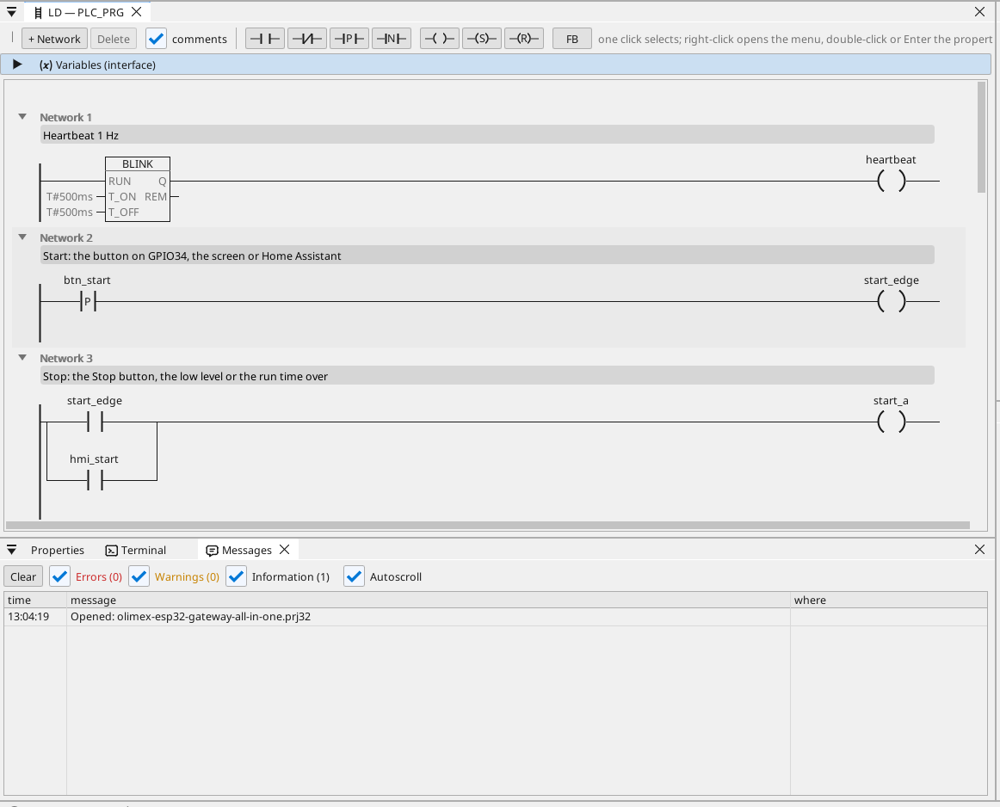

# All-in-one

Egy motorkimenet start / stop vezérléssel, futásidővel, Modbus TCP mérővel, MQTT-vel és kezelőoldallal a böngészőben.

**Letöltés:** [all-in-one.prj32](all-in-one.prj32) - nyisd meg a ctrl32 szerkesztőben (**File → Open**).

## Mit csinál

A program egy kis gépvezérlés - a legtöbb gép ilyen felépítésű:

- A **Start** forrása: a GPIO34 gombja, a kezelőoldal **Start** gombja vagy Home Assistant MQTT-n keresztül.
- A **Stop** jöhet a **Stop** gombról, alacsony szintből vagy a futásidő lejártából - az öntartás ilyenkor lekapcsolja a kimenetet a **GPIO33** lábon.
- A **futásidőt** percben adod meg, és áramszünet után is megmarad.
- A **szint** egy az oldalon beállított változó (a panelnek nem maradt szabad analóg lába).
- A hálózaton egy **Modbus TCP** fogyasztásmérő adja a teljesítményigényt (192.168.1.60 - írd át a saját mérődre).
- **MQTT** közzéteszi az értékeket egy Home Assistant brókernek, amely magától megtalálja őket; a kimenet Home Assistantból is elindítható.
- A **WEBview** a kezelőoldalt a hálózat bármely böngészőjének kiszolgálja.

## A program

## A kezelőoldal

## Megnyitás és futtatás

1. Nyisd meg a `all-in-one.prj32` fájlt a szerkesztőben.
2. Írd át a címeket (a Modbus eszközét, az MQTT brókerét) a saját hálózatodéira.
3. Indítsd el a **szimulációt** (eszköztár), hogy kipróbáld a PC-n, vagy töltsd le a panelre - lásd [A runtime telepítése](../../install.hu.md).

## Amit látnod kell

Nyomd meg a GPIO34 gombját: a GPIO33 kimenete bekapcsol, és a LED-je világít az oldalon. A futásidő után magától kikapcsol. Home Assistantban a panel megjelenik az értékeivel.

---

[← Példaprojektek](../README.hu.md) | [Áttekintés](../../README.hu.md)
