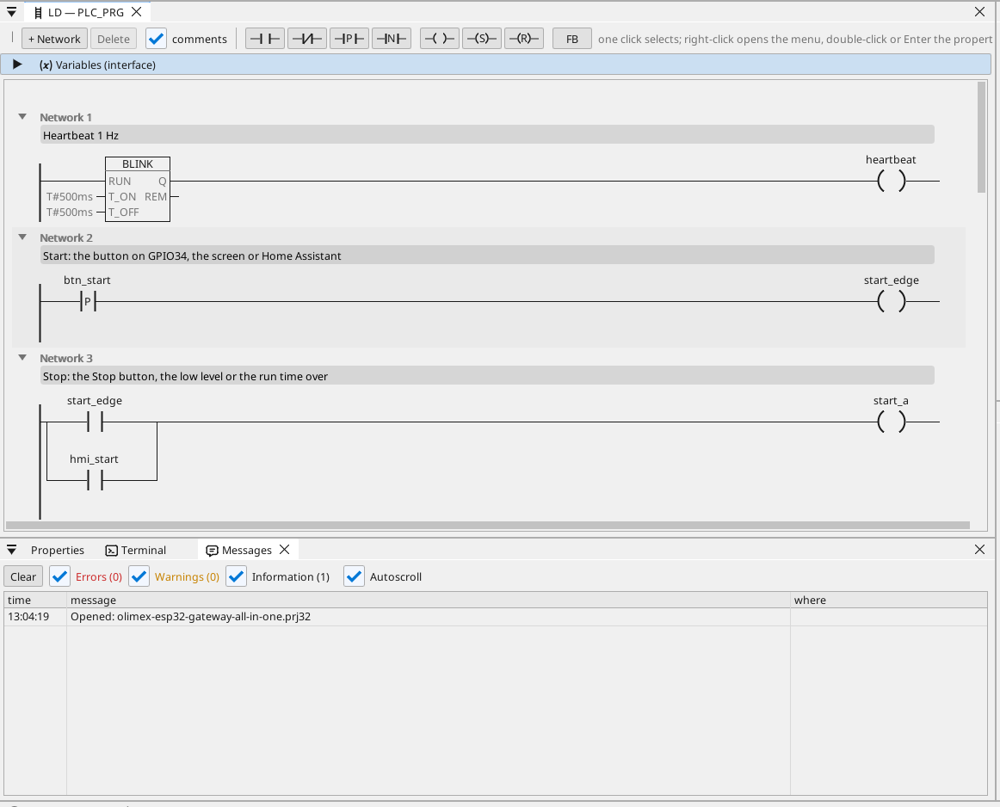
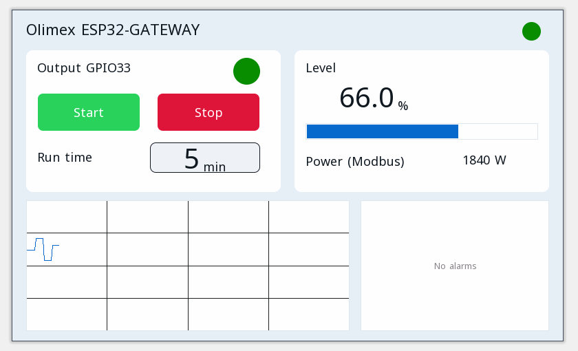

# All-in-one

O ieșire de motor cu start / stop, un temporizator de funcționare, un contor Modbus TCP, MQTT și pagina operatorului într-un browser.

**Descărcare:** [all-in-one.prj32](all-in-one.prj32) - deschide-l în editorul ctrl32 (**File → Open**).

## Ce face

Programul este un mic controler de mașină - forma majorității mașinilor:

- **Start** vine de la butonul de pe GPIO34, de la **Start** de pe pagina operatorului sau din Home Assistant prin MQTT.
- **Stop** vine de la **Stop**, de la un nivel scăzut sau de la expirarea timpului de funcționare - automenținerea oprește ieșirea de pe **GPIO33**.
- **Timpul de funcționare** se setează în minute și se păstrează la o pană de curent.
- **Nivelul** este o variabilă setată pe pagină (plăcii nu îi mai rămâne niciun pin analogic liber).
- Un contor de energie **Modbus TCP** din rețea dă puterea consumată (192.168.1.60 - schimbă-o cu cea a contorului tău).
- **MQTT** publică valorile către un broker Home Assistant, care le găsește singur; ieșirea poate fi pornită și din Home Assistant.
- **WEBview** servește pagina operatorului oricărui browser din rețea.

## Programul

## Pagina operatorului

## Deschide-l și rulează-l

1. Deschide `all-in-one.prj32` în editor.
2. Schimbă adresele (dispozitivul Modbus, brokerul MQTT) cu cele ale rețelei tale.
3. Pornește **simularea** (bara de instrumente) pentru a-l încerca pe PC sau descarcă-l pe placă - vezi [Instalarea runtime-ului](../../install.ro.md).

## Ce ar trebui să vezi

Apasă butonul de pe GPIO34: ieșirea de pe GPIO33 se activează și LED-ul ei de pe pagină se aprinde. După timpul de funcționare se oprește singură. În Home Assistant placa apare cu valorile ei.

---

[← Proiecte exemplu](../README.ro.md) | [Prezentare](../../README.ro.md)
