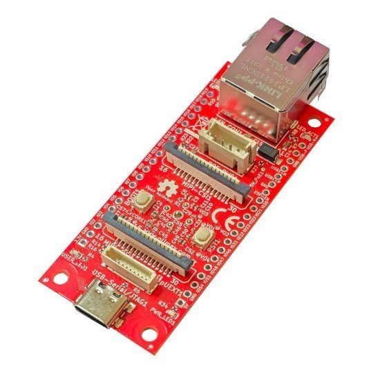

# Olimex ESP32-P4-DevKit

  

La Olimex ESP32-P4-DevKit es una pequeña placa de hardware libre con el ESP32-P4 - el ESP32 más rápido, doble núcleo a 400 MHz con 32 MB de PSRAM - y Ethernet de 100 Mb. No tiene Wi-Fi: es un control cableado. Con ctrl32 ejecuta los programas más grandes que puede un ESP32 - 4096 variables - con su página del operador en cualquier navegador (WEBview), Modbus TCP y MQTT con TLS.

**Ideal para:**

- Un PLC cableado con un programa grande y muchos dispositivos Modbus
- Una pasarela con mucha lógica entre Modbus TCP y MQTT
- El desarrollo de una placa P4 propia

Página de la placa en el catálogo: [Olimex ESP32-P4-DevKit](https://ctrl32.com/hardware/boards/olimex-esp32-p4-devkit/)

## Qué puede hacer ctrl32 en esta placa

<!-- capabilities:start -->
| Característica | En esta placa | Notas |
|---|---|---|
| Chip | ESP32-P4 (ESP32-P4NRW32) |  |
| Memoria | 16 MB flash, 32 MB PSRAM |  |
| Tamaño del programa | 4096 variables, 512 alarmas, 1024 bloques | el editor lo comprueba antes de una descarga |
| Entradas / salidas digitales | 11 GPIO libres | consulta el mapa de pines |
| Entradas analógicas | mediante un ADC I2C (ADS1115) |  |
| Ethernet | sí - IP101GRI |  |
| Wi-Fi | no |  |
| CAN (TWAI) | 1 - en pines libres | necesita un transceptor externo |
| Modbus RTU (RS-485) | sí - en pines libres | necesita un transceptor externo |
| Modbus TCP | cliente y servidor |  |
| MQTT | sí (también TLS) | descubrimiento en Home Assistant |
| WEBview | sí | la página del operador en cualquier navegador |
| Pantalla / táctil (HMI) | no | la página del operador es WEBview |
| USB | USB-C (Native USB) |  |
| Alimentación | 5 V USB, PoE |  |
<!-- capabilities:end -->

### Qué no está soportado

- Los conectores de pantalla MIPI DSI y de cámara CSI - esta placa funciona sin pantalla en ctrl32 (la página del operador es WEBview).
- La ranura microSD - ctrl32 guarda el programa y las pantallas en la flash de la placa.

## La guía

| Paso | Página |
|---|---|
| 1 | [Hardware y cableado](hardware.es.md) - qué necesitas, alimentación, el mapa de pines |
| 2 | [Instalar el runtime](install.es.md) - el editor, la placa, la primera carga |
| 3 | [Configurar](configure.es.md) - red, E/S, comunicación |
| 4 | [Proyectos de ejemplo](examples/README.es.md) - todo lo que hace la placa, listo para abrir |
| - | [Solución de problemas](troubleshooting.es.md) |

## Archivos

-

## Siguientes pasos

- [Documentación de ctrl32](https://ctrl32.com/docs/) - el editor, los lenguajes, cada bloque
- [Descargar el editor](https://ctrl32.com/download/)
- [Todas las placas probadas](../../README.es.md)
- [Makerfabs MaTouch ESP32-P4 7"](../../makerfabs/makerfabs-matouch-esp32-p4-tft-with-touch-7-mipi/README.es.md) - el ESP32-P4 con una pantalla táctil de 7"

