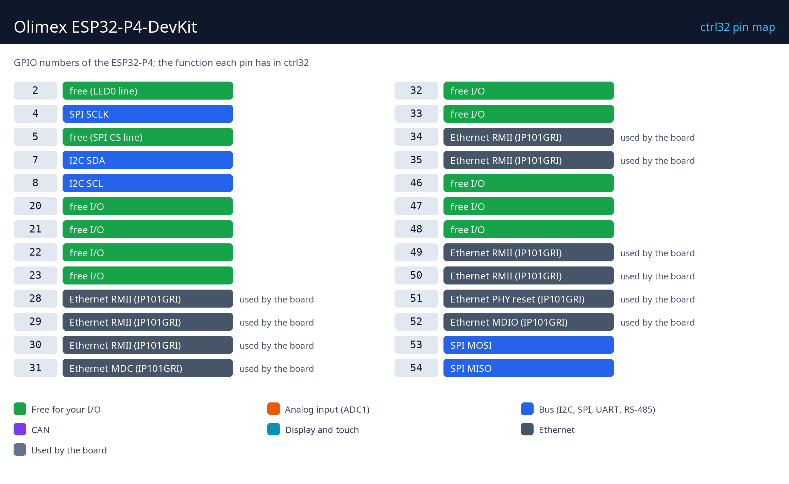

# Olimex ESP32-P4-DevKit

  

The Olimex ESP32-P4-DevKit is a small open-source board with the ESP32-P4 - the fastest ESP32, dual-core 400 MHz with 32 MB of PSRAM - and 100 Mb Ethernet. It has no Wi-Fi: it is a wired controller. With ctrl32 it runs the largest programs an ESP32 can - 4096 variables - with its operator page in any browser (WEBview), Modbus TCP and MQTT with TLS.

**Good for:**

- A wired PLC with a large program and many Modbus devices
- A gateway with heavy logic between Modbus TCP and MQTT
- Development of a P4 board of your own

Board page in the catalog: [Olimex ESP32-P4-DevKit](https://ctrl32.com/hardware/boards/olimex-esp32-p4-devkit/)

## What ctrl32 can do on this board

<!-- capabilities:start -->
| Feature | On this board | Notes |
|---|---|---|
| Chip | ESP32-P4 (ESP32-P4NRW32) |  |
| Memory | 16 MB flash, 32 MB PSRAM |  |
| Program size | 4096 variables, 512 alarms, 1024 blocks | checked by the editor before a download |
| Digital inputs / outputs | 11 free GPIO | see the pin map |
| Analog inputs | through an I2C ADC (ADS1115) |  |
| Ethernet | yes - IP101GRI |  |
| Wi-Fi | no |  |
| CAN (TWAI) | 1 - on free pins | needs an external transceiver |
| Modbus RTU (RS-485) | yes - on free pins | needs an external transceiver |
| Modbus TCP | client and server |  |
| MQTT | yes (TLS too) | Home Assistant discovery |
| WEBview | yes | the operator page in any browser |
| Display / touch (HMI) | no | the operator page is WEBview |
| USB | USB-C (Native USB) |  |
| Power | 5 V USB, PoE |  |
<!-- capabilities:end -->

### What is not supported

- The MIPI DSI display and CSI camera connectors - this board runs headless in ctrl32 (the operator page is WEBview).
- The microSD slot - ctrl32 keeps the program and the screens in the board's flash.

## The guide

| Step | Page |
|---|---|
| 1 | [Hardware and wiring](hardware.md) - what you need, power, the pin map |
| 2 | [Install the runtime](install.md) - the editor, the board, the first upload |
| 3 | [Configure](configure.md) - network, I/O, communication |
| 4 | [Example projects](examples/README.md) - everything the board does, ready to open |
| - | [Troubleshooting](troubleshooting.md) |

## Files

-

## Next steps

- [ctrl32 documentation](https://ctrl32.com/docs/) - the editor, the languages, every block
- [Download the editor](https://ctrl32.com/download/)
- [All tested boards](../../README.md)
- [Makerfabs MaTouch ESP32-P4 7"](../../makerfabs/makerfabs-matouch-esp32-p4-tft-with-touch-7-mipi/README.md) - the ESP32-P4 with a 7" touch screen

