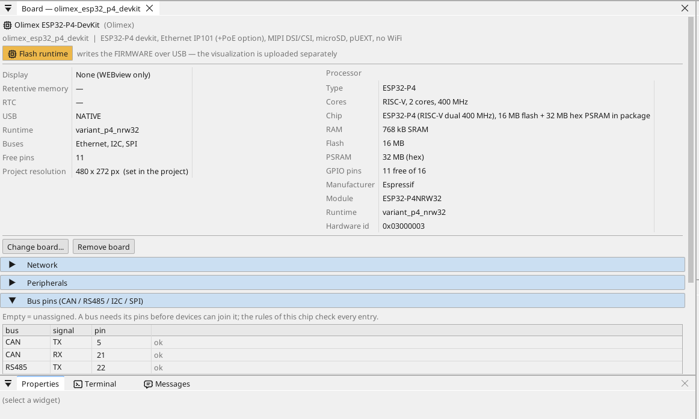
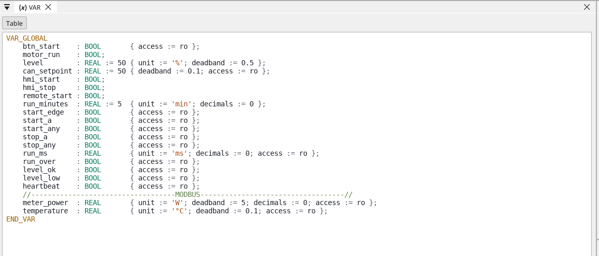
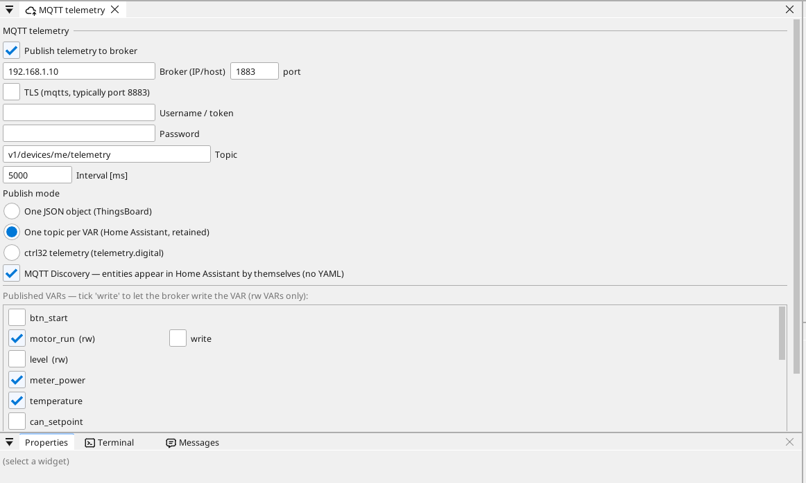

# Configure the board

## The board page

Double-click the board in the device tree. The page shows what the board carries and every pin: a free pin gets a variable in one click - an input, an output, or on an analog-capable pin an analog input.

## Network

The Ethernet port starts by itself and takes its address from your router
(DHCP). A fixed address is set on the board page, in its **Network**
section. The board has no Wi-Fi.

## Inputs, outputs and variables

Every signal of the program is a **variable**. A variable on a pin reads or drives the pin; an analog variable says what is wired to it (a voltage, 4-20 mA, a thermistor) and its range in units.

## Communication

**Modbus TCP.** A device on the network is added under **Ethernet → Modbus TCP master**; its registers become variables.

**Modbus RTU / RS-485.** The board has no RS-485 transceiver: put a 3.3 V transceiver module on free pins (TX, RX and the direction pin DE) and name them on the board page (Bus pins) - ctrl32 is then a Modbus RTU master or slave on that line. Modbus TCP devices on the network need nothing.

**CAN.** The ESP32-P4 has one CAN controller (TWAI). The board has no CAN transceiver: put a 3.3 V transceiver module on two free pins and name them on the board page (Bus pins) - CANopen devices, raw CAN frames and the vehicle buses (J1939) then run on it.

**MQTT.** The board publishes chosen variables to a broker; in the Home Assistant mode the broker finds them by itself, and a variable marked *write* can be set from there.

## WEBview

The board serves its operator page to any browser on the network - open the board's address. The page is drawn in the editor like a screen.

---

[← Install the runtime](install.md) | [Overview](README.md) | [Example projects →](examples/README.md)
