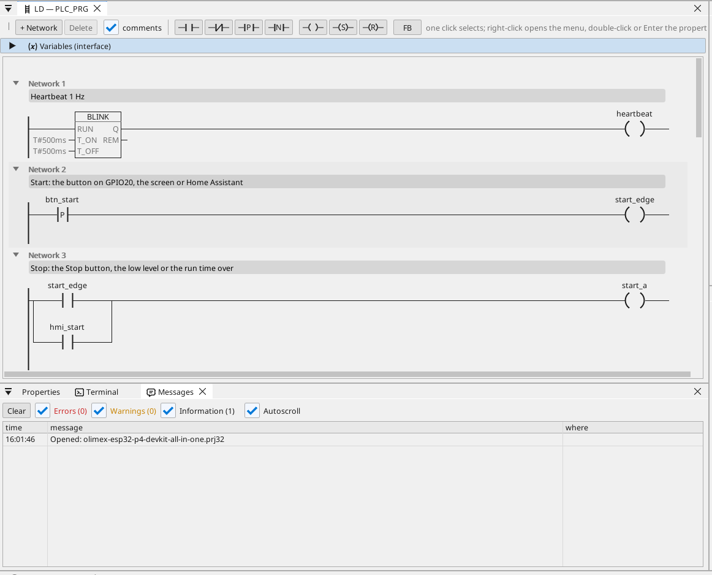
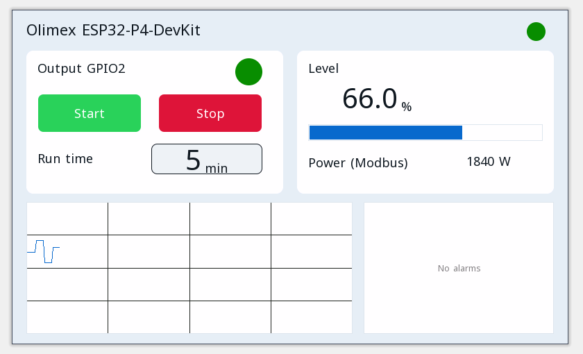

# All-in-one

Un'uscita motore con start / stop, un timer di funzionamento, una temperatura Modbus RTU, frame CAN, un contatore Modbus TCP, MQTT e la pagina operatore in un browser.

**Download:** [all-in-one.prj32](all-in-one.prj32) - aprilo nell'editor ctrl32 (**File → Open**).

## Cosa fa

Il programma è un piccolo controllore di macchina - la forma della maggior parte delle macchine:

- **Start** arriva dal pulsante su GPIO20, da **Start** sulla pagina operatore o da Home Assistant tramite MQTT.
- **Stop** arriva da **Stop**, da un livello basso o dallo scadere del tempo di funzionamento - l'autoritenuta spegne l'uscita su **GPIO2**.
- Il **tempo di funzionamento** si imposta in minuti e si conserva in caso di mancanza di corrente.
- Il **livello** è una variabile impostata sulla pagina (alla scheda non resta alcun pin analogico libero).
- Un sensore **Modbus RTU** sulla RS-485 della scheda fornisce la temperatura (unit 1, input register 1).
- **CAN** invia ogni 100 ms il livello e lo stato dell'uscita nel frame 0x181 e riceve un setpoint nel frame 0x201.
- Un contatore di energia **Modbus TCP** in rete fornisce la potenza assorbita (192.168.1.60 - cambialo con il tuo contatore).
- **MQTT** pubblica i valori su un broker Home Assistant, che li trova da solo; l'uscita si può avviare anche da Home Assistant.
- **WEBview** fornisce la pagina operatore a qualsiasi browser della rete.

## Il programma

## La pagina operatore

## Aprirlo ed eseguirlo

1. Apri `all-in-one.prj32` nell'editor.
2. Cambia gli indirizzi (il dispositivo Modbus, il broker MQTT) con quelli della tua rete.
3. Avvia la **simulazione** (barra degli strumenti) per provarlo sul PC, oppure scaricalo sulla scheda - vedi [Installare il runtime](../../install.it.md).

## Cosa dovresti vedere

Premi il pulsante su GPIO20: l'uscita su GPIO2 si accende e il suo LED sulla pagina si illumina. Trascorso il tempo di funzionamento si spegne da sola. In Home Assistant la scheda compare con i suoi valori.

---

[← Progetti di esempio](../README.it.md) | [Panoramica](../../README.it.md)
