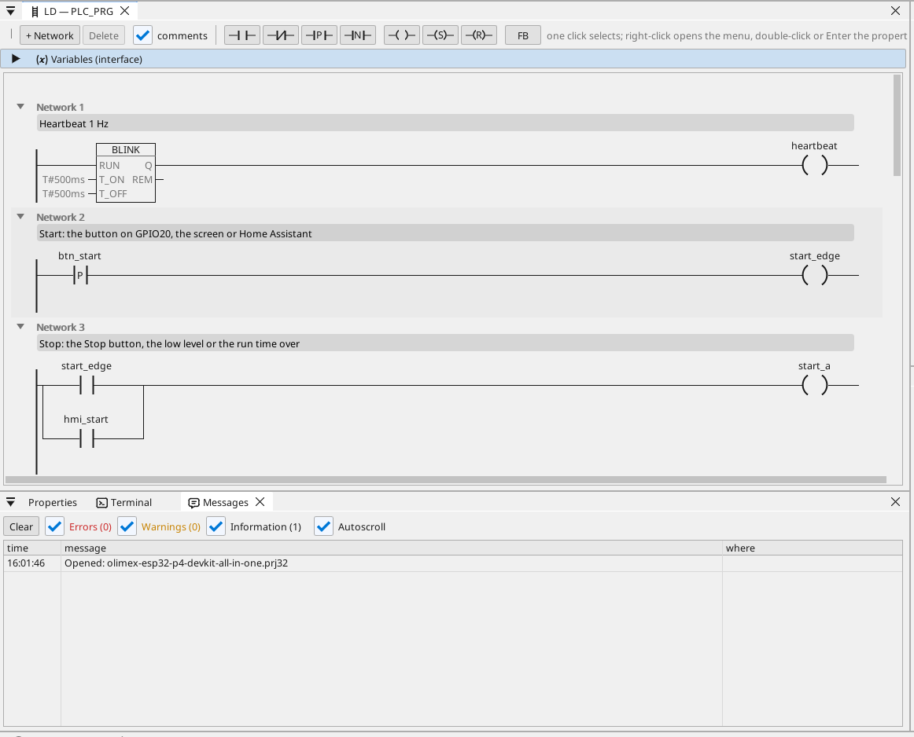
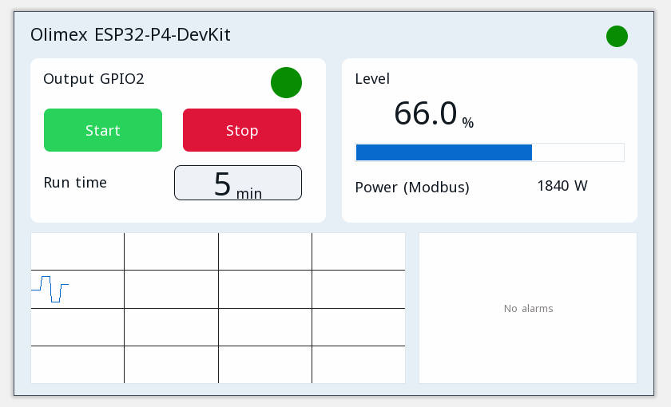

# All-in-one

A motor output with start / stop, a run timer, a Modbus RTU temperature, CAN frames, a Modbus TCP meter, MQTT and the operator page in a browser.

**Download:** [all-in-one.prj32](all-in-one.prj32) - open it in the ctrl32 editor (**File → Open**).

## What it does

The program is a small machine controller - the shape of most machines:

- **Start** comes from the button on GPIO20, from **Start** on the operator page, or from Home Assistant over MQTT.
- **Stop** comes from **Stop**, from a low level or from the run time running out - the latch drops the output on **GPIO2**.
- The **run time** is set in minutes and kept through a power cut.
- The **level** is a variable set on the page (the board has no free analog pin left).
- A **Modbus RTU** sensor on the board's RS-485 gives the temperature (unit 1, input register 1).
- **CAN** sends the level and the output state in frame 0x181 every 100 ms and receives a setpoint in frame 0x201.
- A **Modbus TCP** energy meter on the network gives the power demand (192.168.1.60 - change it to your meter).
- **MQTT** publishes the values to a Home Assistant broker, which finds them by itself; the output can be started from Home Assistant.
- **WEBview** serves the operator page to any browser on the network.

## The program

## The operator page

## Open and run it

1. Open `all-in-one.prj32` in the editor.
2. Change the addresses (the Modbus device, the MQTT broker) to the ones of your network.
3. Run the **simulation** (toolbar) to try it on the PC, or download it to the board - see [Install the runtime](../../install.md).

## What you should see

Press the button on GPIO20: the output on GPIO2 switches on and its LED on the page lights. After the run time it switches off by itself. In Home Assistant the board shows up with its values.

---

[← Example projects](../README.md) | [Overview](../../README.md)
