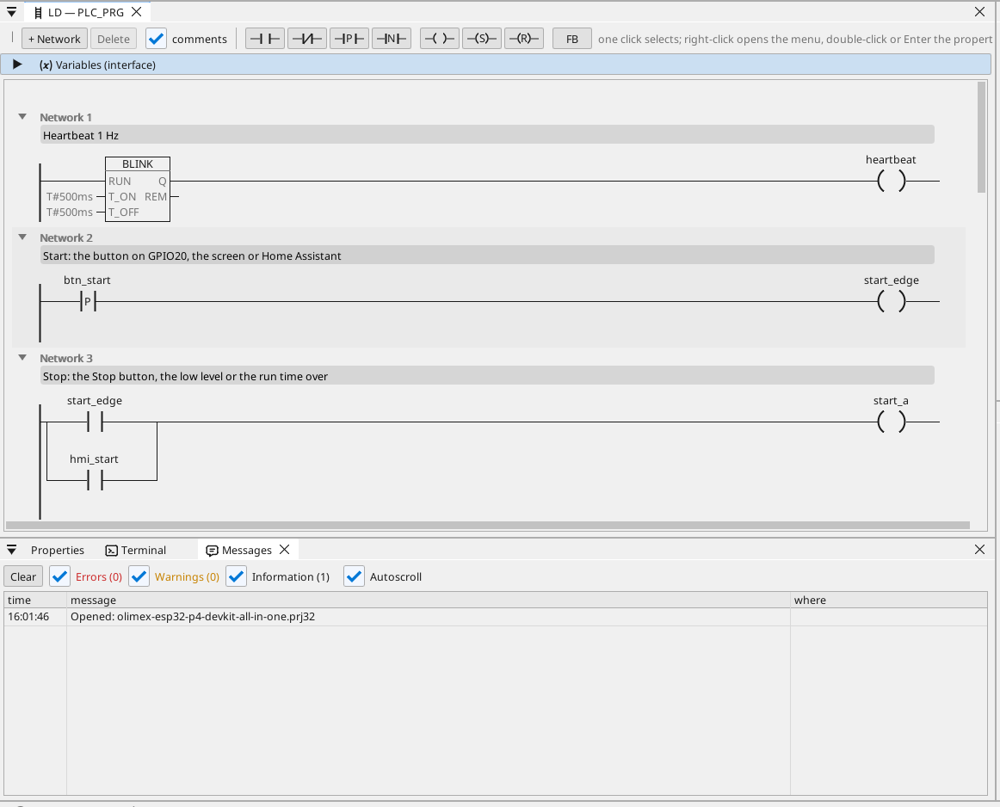
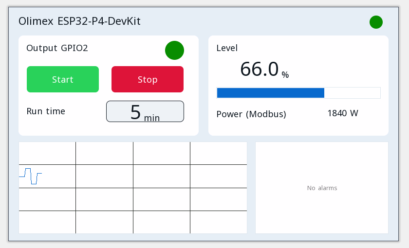

# All-in-one

Výstup motora so štartom a stopom, časom chodu, teplotou z Modbus RTU, rámcami CAN, elektromerom Modbus TCP, MQTT a stránkou operátora v prehliadači.

**Stiahnuť:** [all-in-one.prj32](all-in-one.prj32) - otvor ho v editore ctrl32 (**File → Open**).

## Čo robí

Program je malé riadenie stroja - tvar väčšiny strojov:

- **Štart** príde z tlačidla na GPIO20, z tlačidla **Start** na stránke operátora alebo z Home Assistant cez MQTT.
- **Stop** príde z tlačidla **Stop**, z nízkej hladiny alebo po uplynutí času chodu - pamäť (latch) vypne výstup na **GPIO2**.
- **Čas chodu** sa nastavuje v minútach a prežije výpadok napájania.
- **Hladina** je premenná nastavená na stránke (doske neostal voľný analógový pin).
- Snímač **Modbus RTU** na RS-485 dosky dáva teplotu (unit 1, vstupný register 1).
- **CAN** posiela hladinu a stav výstupu v rámci 0x181 každých 100 ms a prijíma žiadanú hodnotu v rámci 0x201.
- Elektromer **Modbus TCP** v sieti dáva odber (192.168.1.60 - zmeň na adresu svojho elektromera).
- **MQTT** posiela hodnoty do brokera Home Assistant, ktorý si ich nájde sám; výstup sa dá spustiť aj z Home Assistant.
- **WEBview** zobrazí stránku operátora v ľubovoľnom prehliadači v sieti.

## Program

## Stránka operátora

## Otvor a spusti

1. Otvor `all-in-one.prj32` v editore.
2. Zmeň adresy (zariadenie Modbus, broker MQTT) na adresy svojej siete.
3. Spusti **simuláciu** (panel nástrojov) a vyskúšaj ho na PC, alebo ho nahraj do dosky - pozri [Nahratie runtime](../../install.sk.md).

## Čo by si mal vidieť

Stlač tlačidlo na GPIO20: výstup na GPIO2 sa zapne a jeho LED na stránke sa rozsvieti. Po uplynutí času chodu sa sám vypne. V Home Assistant sa doska objaví so svojimi hodnotami.

---

[← Vzorové projekty](../README.sk.md) | [Prehľad](../../README.sk.md)
