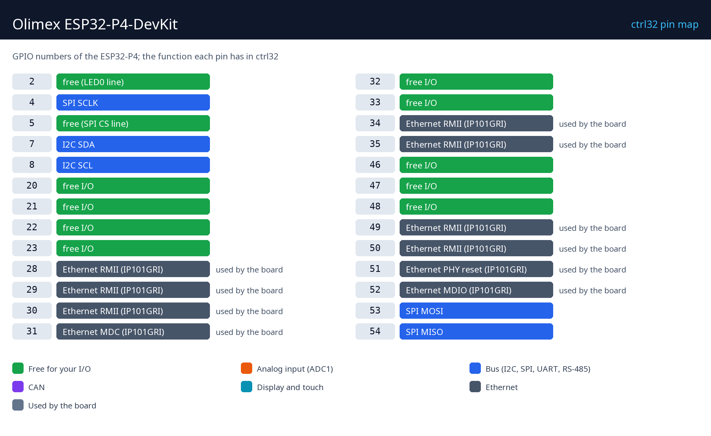

# Hardware a zapojení

## Co je potřeba

- Olimex ESP32-P4-DevKit.
- Datový kabel USB-C - pro nahrání i napájení (5 V).
- Síťový kabel a volný port v síti.
- PC s [editorem ctrl32](https://ctrl32.com/download/) (Windows).
- Volitelně pro příklad all-in-one: LED (GPIO2) je na desce; tlačítko z GPIO20 na GND; 3,3 V převodník CAN na GPIO5 / GPIO21 a převodník RS-485 na GPIO22 / GPIO23 / GPIO32 (DE).

## Napájení

| Zdroj | Kde | Poznámka |
|---|---|---|
| USB 5 V | konektor USB-C | napájení, programování a ladění |
| PoE | přes rozšiřující modul PoE | volitelně |

## Mapa pinů

| GPIO | Funkce v ctrl32 | Poznámka |
|---|---|---|
| 2 | free (LED0 line) |  |
| 4 | SPI SCLK |  |
| 5 | free (SPI CS line) |  |
| 7 | I2C SDA |  |
| 8 | I2C SCL |  |
| 20 | volný I/O |  |
| 21 | volný I/O |  |
| 22 | volný I/O |  |
| 23 | volný I/O |  |
| 28 | Ethernet RMII (IP101GRI) | ⚠ používá deska |
| 29 | Ethernet RMII (IP101GRI) | ⚠ používá deska |
| 30 | Ethernet RMII (IP101GRI) | ⚠ používá deska |
| 31 | Ethernet MDC (IP101GRI) | ⚠ používá deska |
| 32 | volný I/O |  |
| 33 | volný I/O |  |
| 34 | Ethernet RMII (IP101GRI) | ⚠ používá deska |
| 35 | Ethernet RMII (IP101GRI) | ⚠ používá deska |
| 46 | volný I/O |  |
| 47 | volný I/O |  |
| 48 | volný I/O |  |
| 49 | Ethernet RMII (IP101GRI) | ⚠ používá deska |
| 50 | Ethernet RMII (IP101GRI) | ⚠ používá deska |
| 51 | Ethernet PHY reset (IP101GRI) | ⚠ používá deska |
| 52 | Ethernet MDIO (IP101GRI) | ⚠ používá deska |
| 53 | SPI MOSI |  |
| 54 | SPI MISO |  |

Všechny GPIO jsou na dvou 20pinových lištách. ESP32-P4 nemá analogový vstup,
který by ctrl32 používal: analogové signály jdou přes I2C převodník ADC
(ADS1115 na konektoru pUEXT, I2C GPIO7 / GPIO8) nebo přes modul Modbus.

## Bezpečnost

- Deska není určena pro bezpečnostní funkce. Nouzové zastavení, dveřní
  spínač nebo světelná závora se zapojují v hardwaru, nikdy přes program.
- Piny GPIO mají 3,3 V. Signál 24 V potřebuje optočlen nebo převodník
  úrovní; cívka relé potřebuje budič (reléový modul ho má).

---

[← Přehled](README.cs.md) | [Přehled](README.cs.md) | [Nahrání runtime →](install.cs.md)
