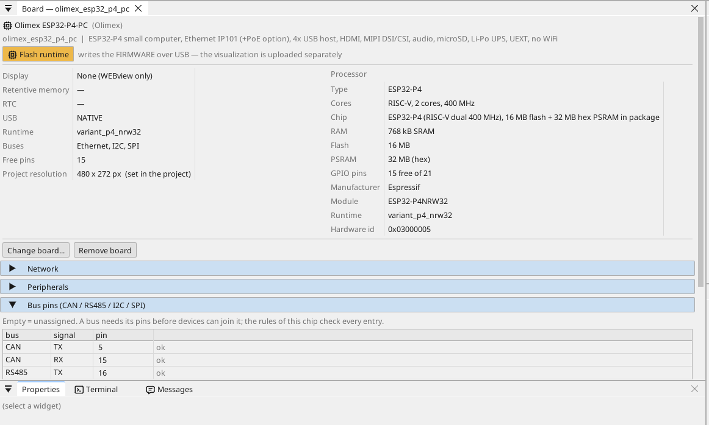
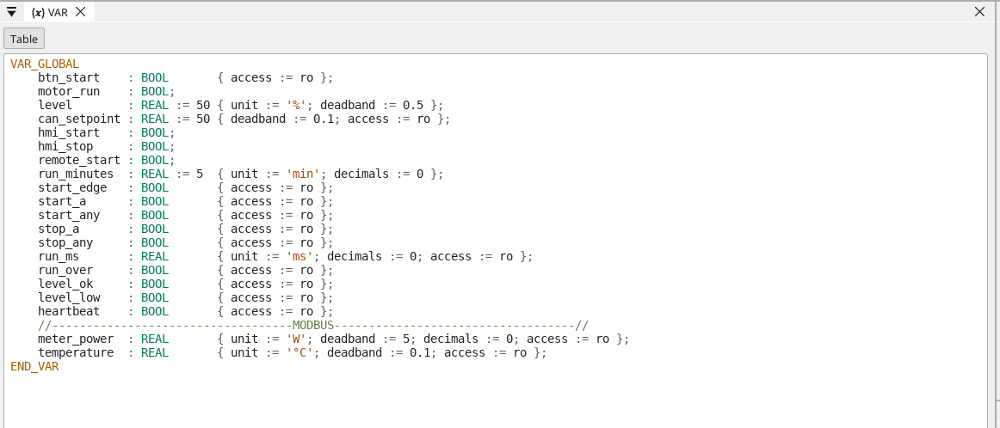
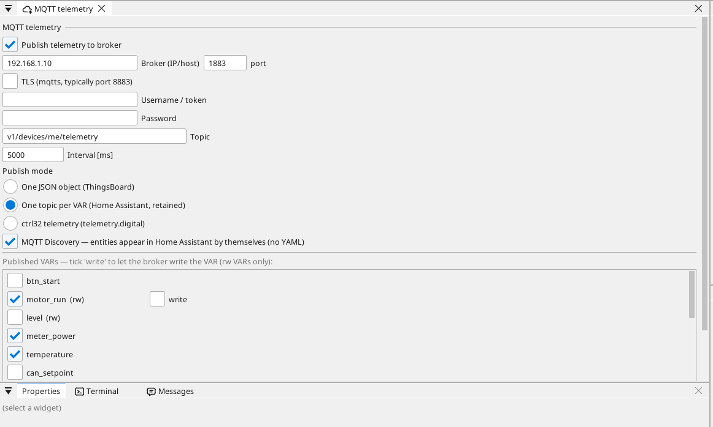

# Das Board einrichten

## Die Board-Seite

Doppelklicken Sie auf das Board im Gerätebaum. Die Seite zeigt, was das Board trägt, und jeden Pin: ein freier Pin bekommt mit einem Klick eine Variable - einen Eingang, einen Ausgang oder an einem analogfähigen Pin einen Analogeingang.

## Netzwerk

Der Ethernet-Port startet von selbst und bezieht seine Adresse von Ihrem
Router (DHCP). Eine feste Adresse vergeben Sie auf der Board-Seite im
Abschnitt **Network**. Das Board hat kein WLAN.

## Eingänge, Ausgänge und Variablen

Jedes Signal des Programms ist eine **Variable**. Eine Variable an einem Pin liest oder treibt den Pin; eine Analogvariable sagt, was daran angeschlossen ist (eine Spannung, 4-20 mA, ein Thermistor), und ihren Bereich in Einheiten.

## Kommunikation

**Modbus TCP.** Ein Gerät im Netzwerk wird unter **Ethernet → Modbus TCP master** hinzugefügt; seine Register werden zu Variablen.

**Modbus RTU / RS-485.** Das Board hat keinen RS-485-Transceiver: Setzen Sie ein 3,3-V-Transceiver-Modul auf freie EXT1-Pins (TX, RX und den Richtungspin DE) und benennen Sie diese auf der Board-Seite - ctrl32 ist dann auf dieser Leitung Modbus-RTU-Master oder -Slave.

**CAN.** Der ESP32-P4 hat einen CAN-Controller (TWAI). Das Board hat keinen Transceiver: Setzen Sie ein 3,3-V-CAN-Transceiver-Modul auf zwei freie EXT1-Pins und benennen Sie diese auf der Board-Seite (**Bus pins**).

**MQTT.** Das Board veröffentlicht gewählte Variablen an einen Broker; im Home-Assistant-Modus findet der Broker sie von selbst, und eine mit *write* markierte Variable lässt sich von dort setzen.

## WEBview

Das Board liefert seine Bedienseite an jeden Browser im Netzwerk - öffnen Sie die Adresse des Boards. Die Seite wird im Editor wie ein Bildschirm gezeichnet.

---

[← Runtime installieren](install.de.md) | [Übersicht](README.de.md) | [Beispielprojekte →](examples/README.de.md)
