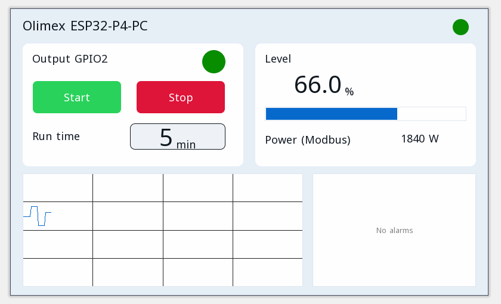

# Proyectos de ejemplo

Cada proyecto se abre en el editor ctrl32 (**File → Open**) y funciona tal cual en la Olimex ESP32-P4-PC.

| | Proyecto | Qué muestra |
|---|---|---|
|  | [All-in-one](all-in-one/README.es.md) | Una salida de motor con marcha / paro, un temporizador de marcha, una temperatura Modbus RTU, tramas CAN, un contador Modbus TCP, MQTT y la página del operador en un navegador. |

---

[← Configurar](../configure.es.md) | [Resumen](../README.es.md) | [Solución de problemas →](../troubleshooting.es.md)
