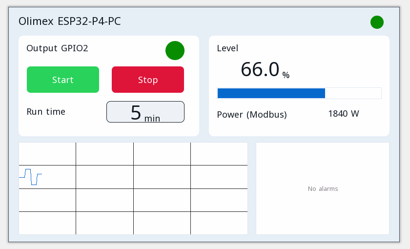

# Projets d'exemple

Chaque projet s'ouvre dans l'éditeur ctrl32 (**File → Open**) et fonctionne tel quel sur la Olimex ESP32-P4-PC.

| | Projet | Ce qu'il montre |
|---|---|---|
|  | [All-in-one](all-in-one/README.fr.md) | Une sortie moteur avec marche / arrêt, une minuterie de marche, une température Modbus RTU, des trames CAN, un compteur Modbus TCP, MQTT et la page opérateur dans un navigateur. |

---

[← Configurer](../configure.fr.md) | [Vue d'ensemble](../README.fr.md) | [Dépannage →](../troubleshooting.fr.md)
