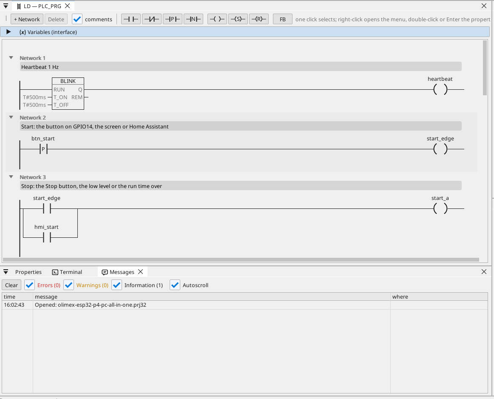
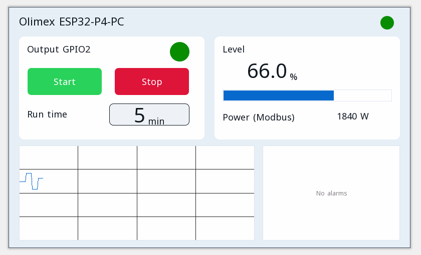

# All-in-one

Ein Motorausgang mit Start / Stop, einer Laufzeit, einer Modbus-RTU-Temperatur, CAN-Frames, einem Modbus-TCP-Zähler, MQTT und der Bedienseite in einem Browser.

**Download:** [all-in-one.prj32](all-in-one.prj32) - öffnen Sie es im ctrl32-Editor (**File → Open**).

## Was es tut

Das Programm ist eine kleine Maschinensteuerung - die Form der meisten Maschinen:

- **Start** kommt von dem Taster an GPIO14, von **Start** auf der Bedienseite oder aus Home Assistant über MQTT.
- **Stop** kommt von **Stop**, von einem niedrigen Füllstand oder vom Ablauf der Laufzeit - die Selbsthaltung schaltet den Ausgang an **GPIO2** ab.
- Die **Laufzeit** wird in Minuten eingestellt und übersteht einen Stromausfall.
- Der **Füllstand** ist eine auf der Seite gesetzte Variable (dem Board bleibt kein freier Analogpin).
- Ein **Modbus-RTU**-Sensor an der RS-485 des Boards liefert die Temperatur (Unit 1, Eingangsregister 1).
- **CAN** sendet alle 100 ms den Füllstand und den Ausgangszustand im Frame 0x181 und empfängt einen Sollwert im Frame 0x201.
- Ein **Modbus-TCP**-Energiezähler im Netzwerk liefert die Leistungsaufnahme (192.168.1.60 - ändern Sie sie auf Ihren Zähler).
- **MQTT** veröffentlicht die Werte an einen Home-Assistant-Broker, der sie von selbst findet; der Ausgang lässt sich auch aus Home Assistant starten.
- **WEBview** liefert die Bedienseite an jeden Browser im Netzwerk.

## Das Programm

## Die Bedienseite

## Öffnen und ausführen

1. Öffnen Sie `all-in-one.prj32` im Editor.
2. Ändern Sie die Adressen (das Modbus-Gerät, den MQTT-Broker) auf die Ihres Netzwerks.
3. Starten Sie die **Simulation** (Symbolleiste), um es am PC auszuprobieren, oder laden Sie es auf das Board - siehe [Runtime installieren](../../install.de.md).

## Was Sie sehen sollten

Drücken Sie den Taster an GPIO14: der Ausgang an GPIO2 schaltet ein und seine LED auf der Seite leuchtet. Nach der Laufzeit schaltet er von selbst ab. In Home Assistant erscheint das Board mit seinen Werten.

---

[← Beispielprojekte](../README.de.md) | [Übersicht](../../README.de.md)
