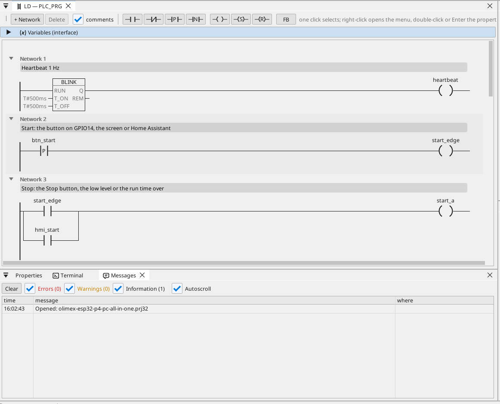
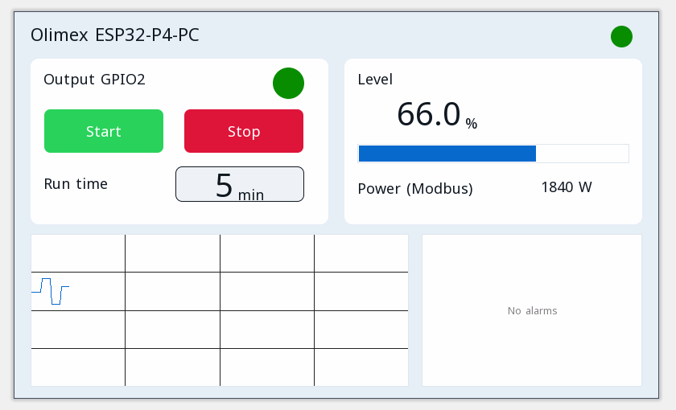

# All-in-one

Вихід двигуна з пуском / зупинкою, таймер роботи, температура Modbus RTU, кадри CAN, лічильник Modbus TCP, MQTT і сторінка оператора в браузері.

**Завантажити:** [all-in-one.prj32](all-in-one.prj32) - відкрийте його в редакторі ctrl32 (**File → Open**).

## Що він робить

Програма - це невеликий контролер - така будова в більшості установок:

- **Start** надходить від кнопки на GPIO14, від **Start** на сторінці оператора або з Home Assistant через MQTT.
- **Stop** надходить від **Stop**, від низького рівня або коли минає час роботи - самоутримання вимикає вихід на **GPIO2**.
- **Час роботи** задається у хвилинах і зберігається після вимкнення живлення.
- **Рівень** - це змінна, що задається на сторінці (на платі не залишилося вільного аналогового піна).
- Датчик **Modbus RTU** на RS-485 плати дає температуру (unit 1, input register 1).
- **CAN** кожні 100 мс надсилає рівень і стан виходу в кадрі 0x181 та отримує уставку в кадрі 0x201.
- Лічильник енергії **Modbus TCP** у мережі дає споживану потужність (192.168.1.60 - змініть на свій лічильник).
- **MQTT** публікує значення на брокер Home Assistant, який сам їх знаходить; вихід можна запустити й з Home Assistant.
- **WEBview** надає сторінку оператора будь-якому браузеру в мережі.

## Програма

## Сторінка оператора

## Відкрийте й запустіть

1. Відкрийте `all-in-one.prj32` у редакторі.
2. Змініть адреси (пристрій Modbus, брокер MQTT) на адреси вашої мережі.
3. Запустіть **симуляцію** (панель інструментів), щоб спробувати на ПК, або завантажте в плату - див. [Встановлення runtime](../../install.uk.md).

## Що ви маєте побачити

Натисніть кнопку на GPIO14: вихід на GPIO2 вмикається, і його світлодіод на сторінці засвічується. Після закінчення часу роботи він вимикається сам. У Home Assistant плата з'являється зі своїми значеннями.

---

[← Приклади проєктів](../README.uk.md) | [Огляд](../../README.uk.md)
