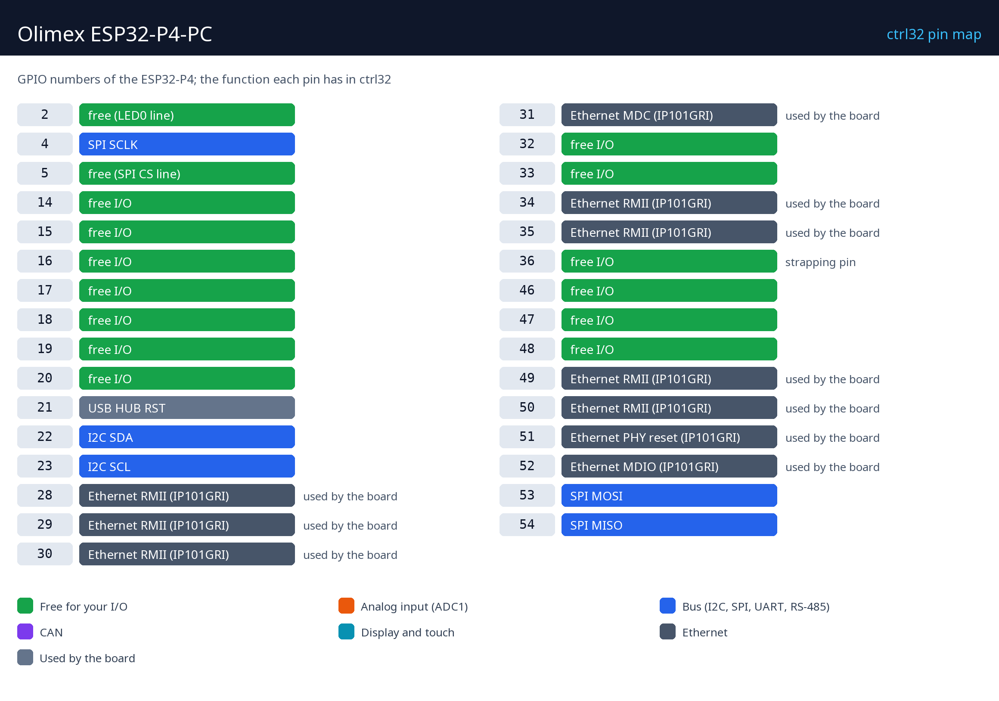
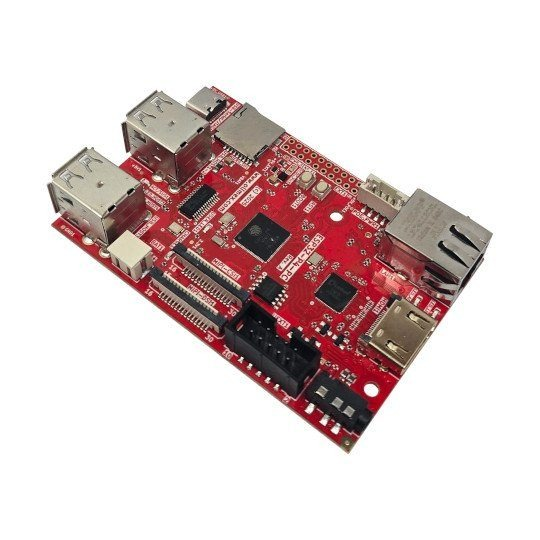
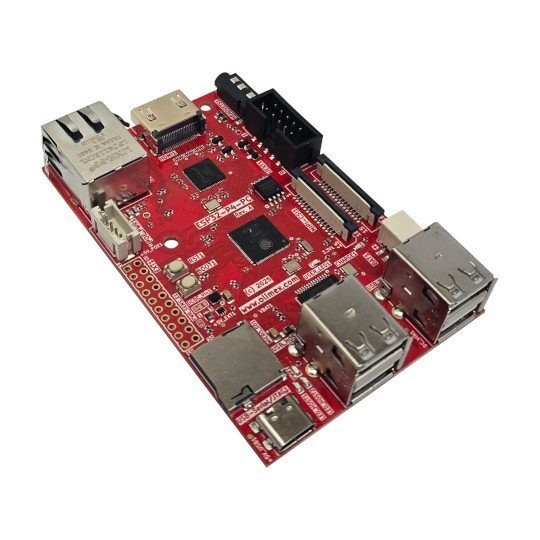
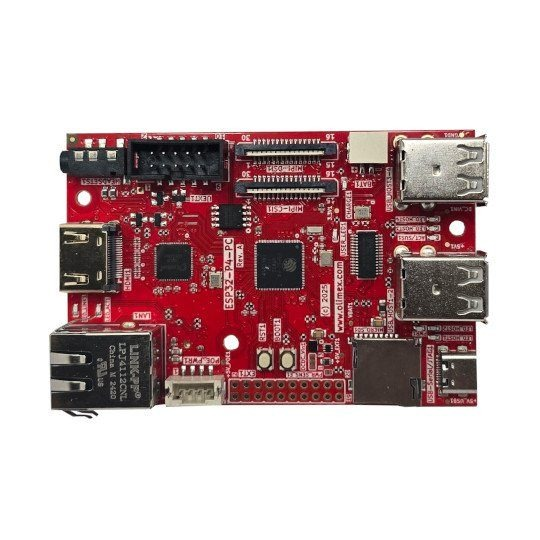
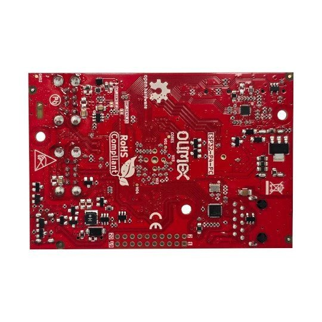

# Hardware and wiring

## What you need

- The Olimex ESP32-P4-PC.
- A USB-C data cable - for the upload and for power (5 V).
- An Ethernet cable and a free port on your network.
- A PC with the [ctrl32 editor](https://ctrl32.com/download/) (Windows).
- Optional: a Li-Po cell for the battery backup; for the all-in-one example the user LED (GPIO2) is on the board and a push-button goes from GPIO14 to GND (EXT1); a 3.3 V CAN transceiver on GPIO5 / GPIO15 and an RS-485 transceiver on GPIO16 / GPIO17 / GPIO18 (DE).

## Power

| Source | Where | Note |
|---|---|---|
| USB 5 V | the USB-C connector | power, programming and debugging |
| Li-Po battery | the battery connector | charged on board; takes over when the supply fails (UPS) |
| PoE | through the PoE extension | optional |

## Pin map

| GPIO | Function in ctrl32 | Note |
|---|---|---|
| 2 | free (LED0 line) |  |
| 4 | SPI SCLK |  |
| 5 | free (SPI CS line) |  |
| 14 | free I/O |  |
| 15 | free I/O |  |
| 16 | free I/O |  |
| 17 | free I/O |  |
| 18 | free I/O |  |
| 19 | free I/O |  |
| 20 | free I/O |  |
| 21 | USB HUB RST | ⚠  |
| 22 | I2C SDA |  |
| 23 | I2C SCL |  |
| 28 | Ethernet RMII (IP101GRI) | ⚠ used by the board |
| 29 | Ethernet RMII (IP101GRI) | ⚠ used by the board |
| 30 | Ethernet RMII (IP101GRI) | ⚠ used by the board |
| 31 | Ethernet MDC (IP101GRI) | ⚠ used by the board |
| 32 | free I/O |  |
| 33 | free I/O |  |
| 34 | Ethernet RMII (IP101GRI) | ⚠ used by the board |
| 35 | Ethernet RMII (IP101GRI) | ⚠ used by the board |
| 36 | free I/O | ⚠ strapping pin |
| 46 | free I/O |  |
| 47 | free I/O |  |
| 48 | free I/O |  |
| 49 | Ethernet RMII (IP101GRI) | ⚠ used by the board |
| 50 | Ethernet RMII (IP101GRI) | ⚠ used by the board |
| 51 | Ethernet PHY reset (IP101GRI) | ⚠ used by the board |
| 52 | Ethernet MDIO (IP101GRI) | ⚠ used by the board |
| 53 | SPI MOSI |  |
| 54 | SPI MISO |  |

The free pins are on the 20-pin **EXT1** header: GPIO14 to GPIO20, 32, 33,
36, 46, 47, 48 and the user LED on GPIO2. The **UEXT** connector carries I2C
(GPIO22 / GPIO23 - shared with the HDMI bridge), SPI (GPIO4 / 53 / 54, CS
GPIO5) and the console UART. The ESP32-P4 has no analog input that ctrl32
uses: analog signals go through an I2C ADC (an ADS1115 on UEXT) or a Modbus
module. CAN and RS-485 go on free EXT1 pins with a 3.3 V transceiver
module.

## Safety

- The board is not intended for safety functions. An emergency stop, a
  door switch or a light curtain is wired in hardware, never through a
  program.
- The GPIO pins are 3.3 V. A 24 V signal needs an opto-coupler or a level
  shifter; a relay coil needs a driver (a relay module has one).

## Photos

---

[← Overview](README.md) | [Overview](README.md) | [Install the runtime →](install.md)
