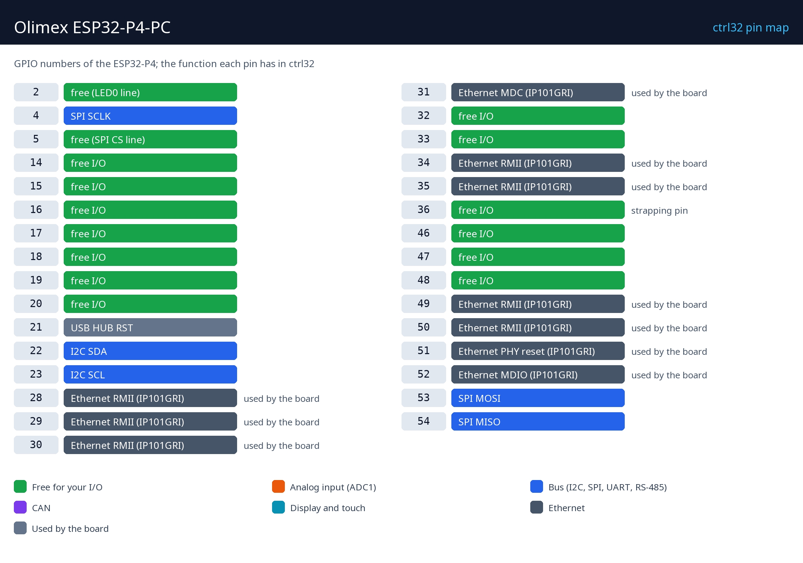
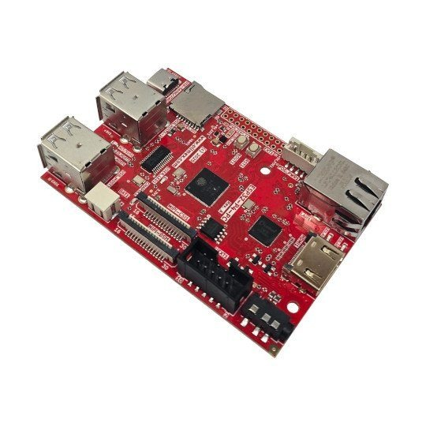
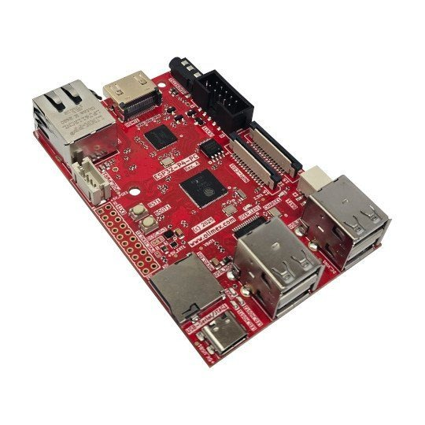
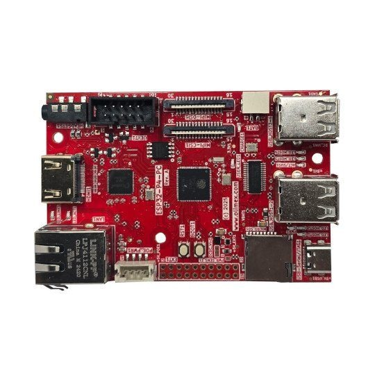
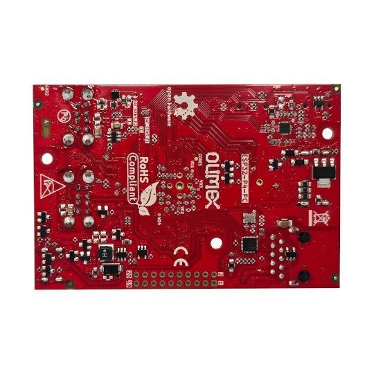

# Hardvér a zapojenie

## Čo treba

- Olimex ESP32-P4-PC.
- Dátový kábel USB-C - na nahratie aj napájanie (5 V).
- Sieťový kábel a voľný port v sieti.
- PC s [editorom ctrl32](https://ctrl32.com/download/) (Windows).
- Voliteľne: článok Li-Po na zálohovanie batériou; pre príklad all-in-one je používateľská LED (GPIO2) na doske a tlačidlo ide z GPIO14 na GND (EXT1); 3,3 V prevodník CAN na GPIO5 / GPIO15 a prevodník RS-485 na GPIO16 / GPIO17 / GPIO18 (DE).

## Napájanie

| Zdroj | Kde | Poznámka |
|---|---|---|
| USB 5 V | konektor USB-C | napájanie, programovanie a ladenie |
| Li-Po batéria | konektor batérie | nabíja sa na doske; pri výpadku zdroja prevezme napájanie (UPS) |
| PoE | cez rozširujúci modul PoE | voliteľne |

## Mapa pinov

| GPIO | Funkcia v ctrl32 | Poznámka |
|---|---|---|
| 2 | free (LED0 line) |  |
| 4 | SPI SCLK |  |
| 5 | free (SPI CS line) |  |
| 14 | voľný I/O |  |
| 15 | voľný I/O |  |
| 16 | voľný I/O |  |
| 17 | voľný I/O |  |
| 18 | voľný I/O |  |
| 19 | voľný I/O |  |
| 20 | voľný I/O |  |
| 21 | USB HUB RST | ⚠  |
| 22 | I2C SDA |  |
| 23 | I2C SCL |  |
| 28 | Ethernet RMII (IP101GRI) | ⚠ používa doska |
| 29 | Ethernet RMII (IP101GRI) | ⚠ používa doska |
| 30 | Ethernet RMII (IP101GRI) | ⚠ používa doska |
| 31 | Ethernet MDC (IP101GRI) | ⚠ používa doska |
| 32 | voľný I/O |  |
| 33 | voľný I/O |  |
| 34 | Ethernet RMII (IP101GRI) | ⚠ používa doska |
| 35 | Ethernet RMII (IP101GRI) | ⚠ používa doska |
| 36 | voľný I/O | ⚠ strapping pin |
| 46 | voľný I/O |  |
| 47 | voľný I/O |  |
| 48 | voľný I/O |  |
| 49 | Ethernet RMII (IP101GRI) | ⚠ používa doska |
| 50 | Ethernet RMII (IP101GRI) | ⚠ používa doska |
| 51 | Ethernet PHY reset (IP101GRI) | ⚠ používa doska |
| 52 | Ethernet MDIO (IP101GRI) | ⚠ používa doska |
| 53 | SPI MOSI |  |
| 54 | SPI MISO |  |

Voľné piny sú na 20-pinovej lište **EXT1**: GPIO14 až GPIO20, 32, 33, 36,
46, 47, 48 a používateľská LED na GPIO2. Konektor **UEXT** nesie I2C
(GPIO22 / GPIO23 - zdieľané s mostíkom HDMI), SPI (GPIO4 / 53 / 54, CS
GPIO5) a UART konzoly. ESP32-P4 nemá analógový vstup, ktorý by ctrl32
používal: analógové signály idú cez I2C prevodník ADC (ADS1115 na UEXT)
alebo cez modul Modbus. CAN a RS-485 idú na voľné piny EXT1 s 3,3 V
modulom prevodníka.

## Bezpečnosť

- Doska nie je určená na bezpečnostné funkcie. Núdzové zastavenie, dverový
  spínač či svetelná závora sa zapájajú v hardvéri, nikdy cez program.
- Piny GPIO majú 3,3 V. Signál 24 V potrebuje optočlen alebo prevodník
  úrovní; cievka relé potrebuje budič (reléový modul ho má).

## Fotky

---

[← Prehľad](README.sk.md) | [Prehľad](README.sk.md) | [Nahratie runtime →](install.sk.md)
