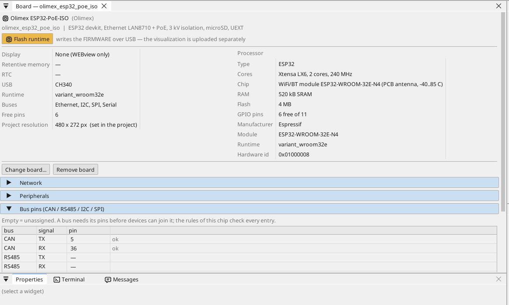
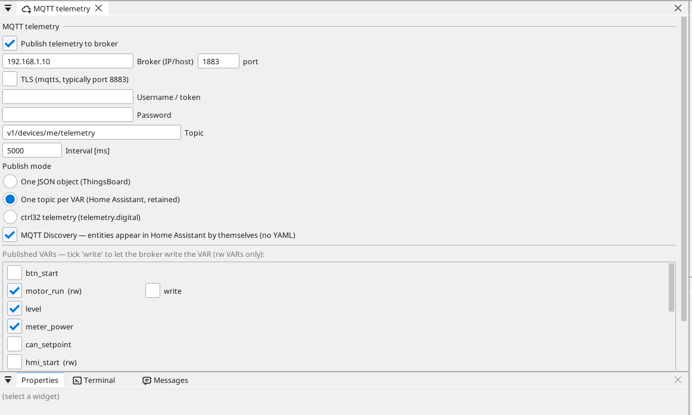

# Configure the board

## The board page

Double-click the board in the device tree. The page shows what the board carries and every pin: a free pin gets a variable in one click - an input, an output, or on an analog-capable pin an analog input.

## Network

The Ethernet port starts by itself. By default the board takes its
address from your router (DHCP) and announces itself on the network by
its name (`<project>.local`). To give it a fixed address, open the board
page and its **Network** section.

**Wi-Fi.** The ESP32 also has Wi-Fi (open **WiFi** in the device tree).
In a cabinet the cable is the better road: it carries the power as well,
and nothing on the board has to be set for it.

## Inputs, outputs and variables

Every signal of the program is a **variable**. A variable on a pin reads or drives the pin; an analog variable says what is wired to it (a voltage, 4-20 mA, a thermistor) and its range in units.

## Communication

**Modbus TCP.** A device on the network is added under **Ethernet → Modbus TCP master**; its registers become variables.

**Modbus RTU / RS-485.** There is no RS-485 transceiver on the board. Modbus devices are reached over Modbus TCP, directly or through a Modbus TCP / RTU gateway.

**CAN.** The ESP32 has one CAN controller (TWAI), but this board does not bring it out to a transceiver, so ctrl32 does not offer CAN here. For CAN pick a board that carries it, such as the [ESP32-EVB](../olimex-esp32-evb/README.md).

**MQTT.** The board publishes chosen variables to a broker; in the Home Assistant mode the broker finds them by itself, and a variable marked *write* can be set from there.

## WEBview

The board serves its operator page to any browser on the network - open the board's address. The page is drawn in the editor like a screen.

---

[← Install the runtime](install.md) | [Overview](README.md) | [Example projects →](examples/README.md)
