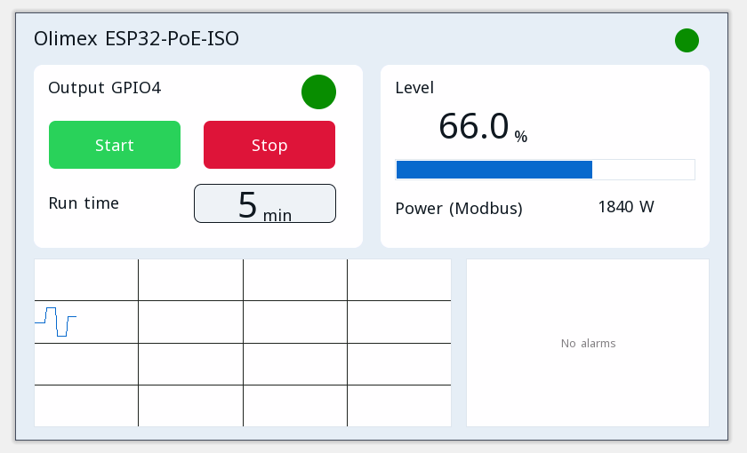

# Beispielprojekte

Jedes Projekt öffnet sich im ctrl32-Editor (**File → Open**) und läuft so, wie es ist, auf dem Olimex ESP32-PoE-ISO.

| | Projekt | Was es zeigt |
|---|---|---|
|  | [All-in-one](all-in-one/README.de.md) | Ein Motorausgang mit Start / Stop, einer Laufzeit, einem analogen Füllstand, CAN-Frames, einem Modbus-TCP-Zähler, MQTT und der Bedienseite in einem Browser. |

---

[← Einrichten](../configure.de.md) | [Übersicht](../README.de.md) | [Fehlersuche →](../troubleshooting.de.md)
