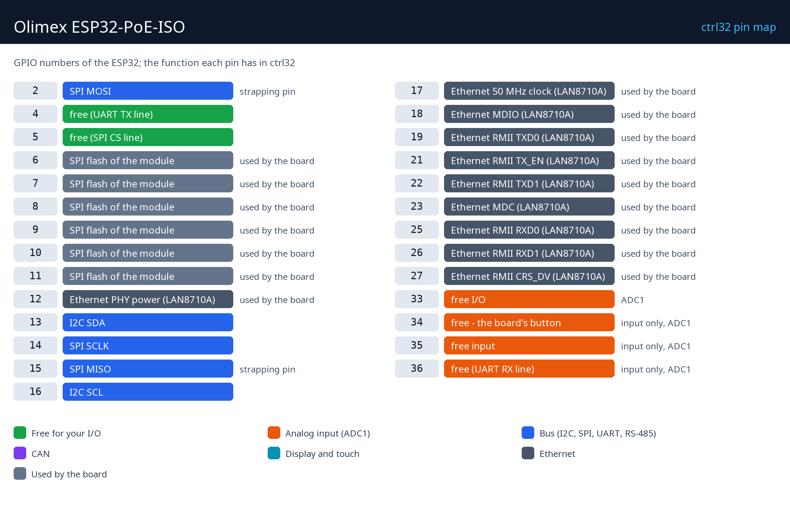

# Hardware and wiring

## What you need

- The Olimex ESP32-PoE-ISO (the WROOM-32E variant, without PSRAM).
- A micro-USB data cable - for the first upload of the runtime.
- For power: a PoE switch / injector (IEEE 802.3af), or a 5 V USB supply.
- An Ethernet cable and a free port on your network.
- A PC with the [ctrl32 editor](https://ctrl32.com/download/) (Windows).
- Optional, for the all-in-one example: the button BUT1 is on the board; a relay module or an LED with a resistor on GPIO4 (UEXT); a potentiometer (10 k) between 3.3 V and GND with its wiper on GPIO33 (EXT2); a 3.3 V CAN transceiver on GPIO5 (TX) / GPIO36 (RX).

## Power

| Source | Where | Note |
|---|---|---|
| PoE | the Ethernet jack, from a PoE switch or injector | IEEE 802.3af, isolated |
| USB 5 V | the micro-USB connector | the road for the first upload |
| Li-Po battery | the battery connector | charged on board |

The PoE supply is **galvanically isolated** from the board: unlike the
plain ESP32-PoE, USB to a PC and PoE may be connected at the same time -
the runtime can be uploaded and watched online while the board stays on
its PoE switch.

## Pin map

| GPIO | Function in ctrl32 | Note |
|---|---|---|
| 2 | SPI MOSI | ⚠ strapping pin |
| 4 | free (UART TX line) |  |
| 5 | free (SPI CS line) |  |
| 6 | SPI flash of the module | ⚠ used by the board |
| 7 | SPI flash of the module | ⚠ used by the board |
| 8 | SPI flash of the module | ⚠ used by the board |
| 9 | SPI flash of the module | ⚠ used by the board |
| 10 | SPI flash of the module | ⚠ used by the board |
| 11 | SPI flash of the module | ⚠ used by the board |
| 12 | Ethernet PHY power (LAN8710A) | ⚠ used by the board |
| 13 | I2C SDA |  |
| 14 | SPI SCLK |  |
| 15 | SPI MISO | ⚠ strapping pin |
| 16 | I2C SCL |  |
| 17 | Ethernet 50 MHz clock (LAN8710A) | ⚠ used by the board |
| 18 | Ethernet MDIO (LAN8710A) | ⚠ used by the board |
| 19 | Ethernet RMII TXD0 (LAN8710A) | ⚠ used by the board |
| 21 | Ethernet RMII TX_EN (LAN8710A) | ⚠ used by the board |
| 22 | Ethernet RMII TXD1 (LAN8710A) | ⚠ used by the board |
| 23 | Ethernet MDC (LAN8710A) | ⚠ used by the board |
| 25 | Ethernet RMII RXD0 (LAN8710A) | ⚠ used by the board |
| 26 | Ethernet RMII RXD1 (LAN8710A) | ⚠ used by the board |
| 27 | Ethernet RMII CRS_DV (LAN8710A) | ⚠ used by the board |
| 33 | free I/O | ADC1 |
| 34 | free - the board's button | ⚠ input only, ADC1 |
| 35 | free input | ⚠ input only, ADC1 |
| 36 | free (UART RX line) | ⚠ input only, ADC1 |

The free pins sit on the **EXT1 / EXT2** headers (2.54 mm) and on the
**UEXT** connector. GPIO34 to GPIO39 are inputs only - an output there is
refused by the editor. The UEXT connector carries I2C (GPIO13 / GPIO16)
and SPI (GPIO14 / GPIO2 / GPIO15, shared with the microSD slot).

## Safety

- The board is not intended for safety functions. An emergency stop, a
  door switch or a light curtain is wired in hardware, never through a
  program.
- The GPIO pins are 3.3 V. A 24 V input needs an opto-coupler or a level
  shifter; a relay coil needs a driver (a relay module has one).

---

[← Overview](README.md) | [Overview](README.md) | [Install the runtime →](install.md)
