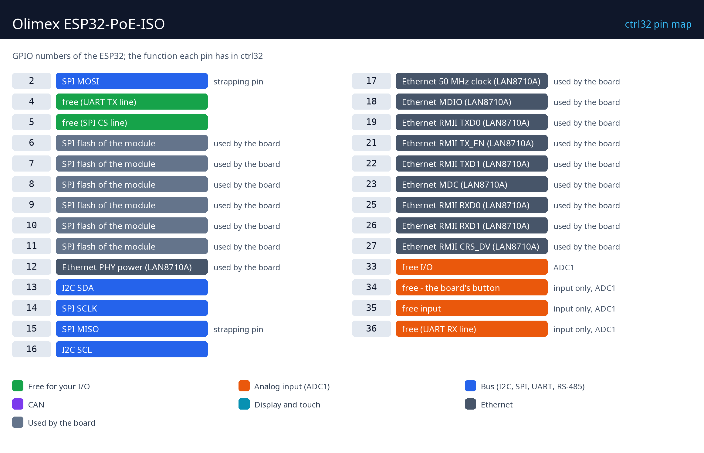

# Hardware și cablare

## De ce ai nevoie

- Olimex ESP32-PoE-ISO (varianta WROOM-32E, fără PSRAM).
- Un cablu de date micro-USB - pentru prima încărcare a runtime-ului.
- Pentru alimentare: un switch / injector PoE (IEEE 802.3af) sau o sursă USB de 5 V.
- Un cablu Ethernet și un port liber în rețeaua ta.
- Un PC cu [editorul ctrl32](https://ctrl32.com/download/) (Windows).
- Opțional, pentru exemplul all-in-one: butonul BUT1 este pe placă; un modul de releu sau un LED cu rezistor pe GPIO4 (UEXT); un potențiometru (10 k) între 3,3 V și GND cu cursorul pe GPIO33 (EXT2); un transceiver CAN de 3,3 V pe GPIO5 (TX) / GPIO36 (RX).

## Alimentare

| Sursă | Unde | Notă |
|---|---|---|
| PoE | mufa Ethernet, de la un switch sau injector PoE | IEEE 802.3af, izolat |
| USB 5 V | conectorul micro-USB | calea pentru prima încărcare |
| Acumulator Li-Po | conectorul de acumulator | încărcat pe placă |

Alimentarea PoE este **izolată galvanic** de placă: spre deosebire de
ESP32-PoE simplu, USB către un PC și PoE pot fi conectate în același
timp - runtime-ul poate fi încărcat și urmărit online în timp ce placa
rămâne pe switch-ul ei PoE.

## Harta pinilor

| GPIO | Funcție în ctrl32 | Notă |
|---|---|---|
| 2 | SPI MOSI | ⚠ pin de strapping |
| 4 | free (UART TX line) |  |
| 5 | free (SPI CS line) |  |
| 6 | Flash SPI al modulului | ⚠ folosit de placă |
| 7 | Flash SPI al modulului | ⚠ folosit de placă |
| 8 | Flash SPI al modulului | ⚠ folosit de placă |
| 9 | Flash SPI al modulului | ⚠ folosit de placă |
| 10 | Flash SPI al modulului | ⚠ folosit de placă |
| 11 | Flash SPI al modulului | ⚠ folosit de placă |
| 12 | Ethernet PHY power (LAN8710A) | ⚠ folosit de placă |
| 13 | I2C SDA |  |
| 14 | SPI SCLK |  |
| 15 | SPI MISO | ⚠ pin de strapping |
| 16 | I2C SCL |  |
| 17 | Ethernet 50 MHz clock (LAN8710A) | ⚠ folosit de placă |
| 18 | Ethernet MDIO (LAN8710A) | ⚠ folosit de placă |
| 19 | Ethernet RMII TXD0 (LAN8710A) | ⚠ folosit de placă |
| 21 | Ethernet RMII TX_EN (LAN8710A) | ⚠ folosit de placă |
| 22 | Ethernet RMII TXD1 (LAN8710A) | ⚠ folosit de placă |
| 23 | Ethernet MDC (LAN8710A) | ⚠ folosit de placă |
| 25 | Ethernet RMII RXD0 (LAN8710A) | ⚠ folosit de placă |
| 26 | Ethernet RMII RXD1 (LAN8710A) | ⚠ folosit de placă |
| 27 | Ethernet RMII CRS_DV (LAN8710A) | ⚠ folosit de placă |
| 33 | liber - I/O | ADC1 |
| 34 | liber - butonul plăcii | ⚠ doar intrare, ADC1 |
| 35 | liber - intrare | ⚠ doar intrare, ADC1 |
| 36 | free (UART RX line) | ⚠ doar intrare, ADC1 |

Pinii liberi se află pe conectorii **EXT1 / EXT2** (2,54 mm) și pe
conectorul **UEXT**. GPIO34 până la GPIO39 sunt doar intrări - editorul
refuză o ieșire acolo. Conectorul UEXT poartă I2C (GPIO13 / GPIO16) și SPI
(GPIO14 / GPIO2 / GPIO15, partajat cu slotul microSD).

## Siguranță

- Placa nu este destinată funcțiilor de siguranță. O oprire de urgență,
  un contact de ușă sau o barieră optică se cablează în hardware,
  niciodată printr-un program.
- Pinii GPIO sunt de 3,3 V. O intrare de 24 V are nevoie de un optocuplor
  sau de un convertor de nivel; o bobină de releu are nevoie de un driver
  (un modul de releu are unul).

---

[← Prezentare](README.ro.md) | [Prezentare](README.ro.md) | [Instalarea runtime-ului →](install.ro.md)
