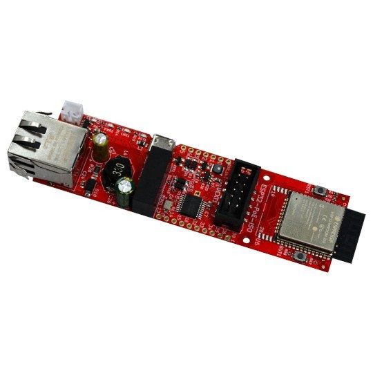
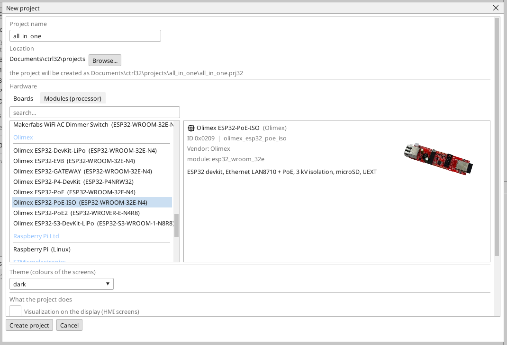
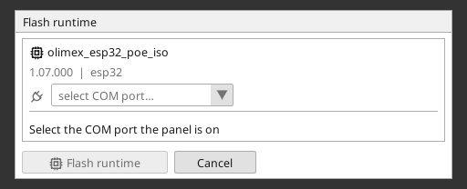
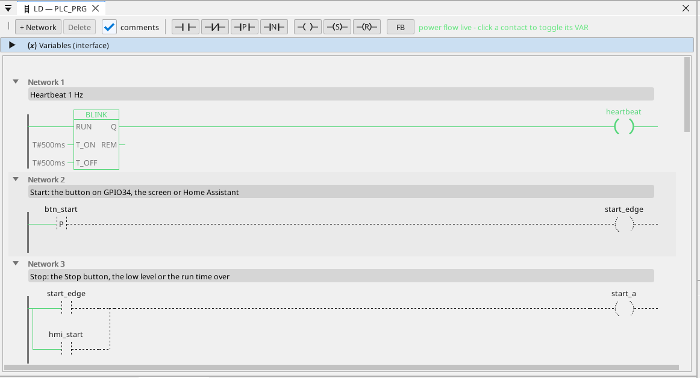

# Instalar el runtime de ctrl32

El runtime es el programa de la placa que ejecuta tu proyecto - el ciclo del PLC, las pantallas, la comunicación. Se pone en la placa una vez; después, cada cambio del proyecto es una descarga que no reescribe nada más que el proyecto.

## 1. Conectar la placa

Conecta la placa al PC con el cable USB. La placa tiene un convertidor USB-UART CH340T. Windows 10 y 11 instalan su
driver por sí solos; si el puerto no aparece, instala el driver CH340 del
fabricante del chip (WCH) y vuelve a enchufar el cable. La placa pasa sola
al modo de descarga - no hace falta pulsar ningún botón.

## 2. Crear el proyecto

Inicia el editor ctrl32 y elige **New project** (Ctrl+N). Escribe el **nombre** del proyecto, elige **Olimex ESP32-PoE-ISO** en la lista de placas (en **Olimex**) y pulsa **Create project**.

Para empezar en cambio desde el ejemplo listo, abre el [proyecto all-in-one](examples/all-in-one/README.es.md) (**File → Open**).

## 3. Escribir el runtime

Elige el puerto COM de la placa en el selector de puertos de la barra de herramientas, haz clic en la placa en el árbol de dispositivos y pulsa **Flash runtime**. El editor escribe el runtime, lo vuelve a leer y lo verifica; tarda alrededor de un minuto y la placa se reinicia. Esto se hace una vez - y de nuevo solo cuando el editor trae una nueva línea de runtime.

## 4. Descargar el proyecto

Pulsa el botón de descarga de la barra de herramientas (F5). El editor compila el proyecto, lo escribe en la ranura de programa inactiva de la placa, lo verifica y solo entonces cambia - una descarga fallida deja intacto el programa en ejecución.

## 5. Comprobar que funciona

Pulsa **ONLINE** (el icono del enchufe junto al selector de puertos) para observar el programa en la placa: lo que conduce está en verde y cada variable lleva su valor en vivo. Sin una placa a mano, la misma vista la da la **simulación** (el botón de la barra de herramientas junto a ONLINE).

¿Algo no funciona? Consulta [Solución de problemas](troubleshooting.es.md).

*Capturas de pantalla: editor ctrl32 1.07.*

---

[← Hardware y cableado](hardware.es.md) | [Resumen](README.es.md) | [Configurar →](configure.es.md)
