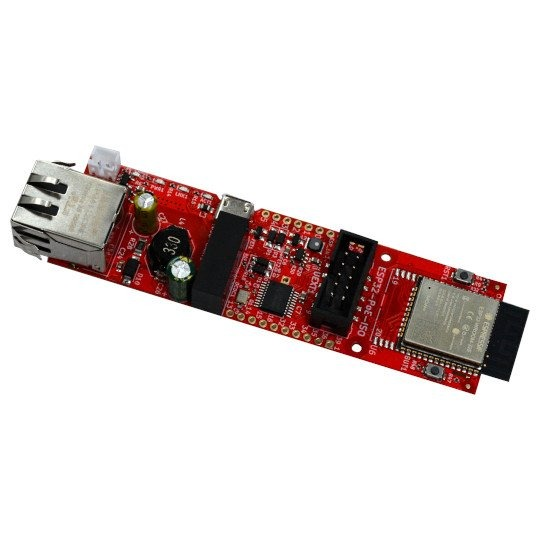
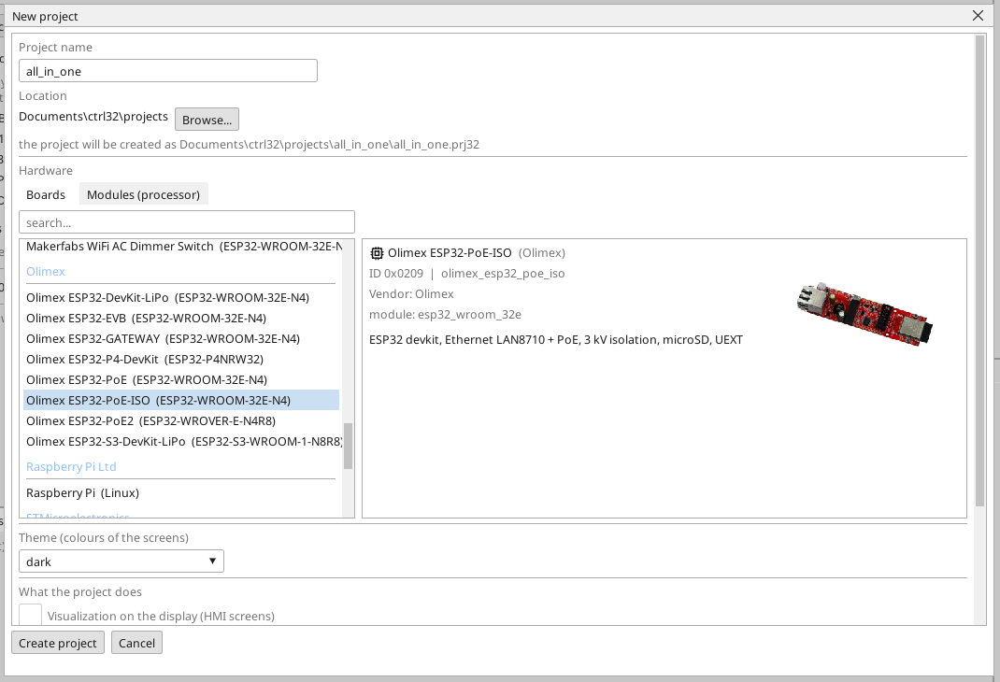
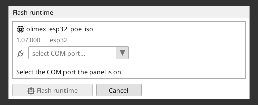
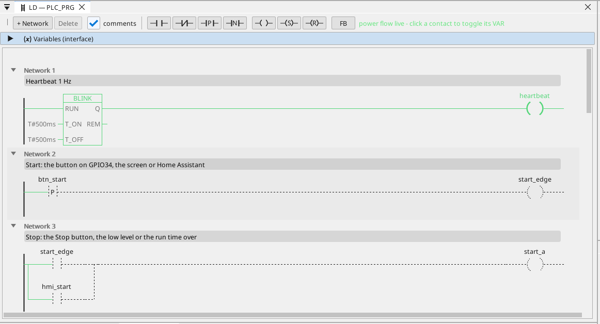

# Install the ctrl32 runtime

The runtime is the program on the board that runs your project - the PLC cycle, the screens, the communication. It goes on the board once; after that every change of the project is a download that rewrites nothing but the project.

## 1. Connect the board

Connect the board to the PC with the USB cable. The board has a CH340T USB-UART converter. Windows 10 and 11 install its
driver by themselves; if the port does not appear, install the CH340
driver from the chip maker (WCH) and plug the cable in again.
The board switches to download mode by itself - no button is needed.

## 2. Create the project

Start the ctrl32 editor and choose **New project** (Ctrl+N). Type the project's **name**, pick **Olimex ESP32-PoE-ISO** in the list of boards (under **Olimex**) and press **Create project**.

To start from the ready example instead, open the [all-in-one project](examples/all-in-one/README.md) (**File → Open**).

## 3. Write the runtime

Pick the board's COM port in the toolbar's port picker, click the board in the device tree and press **Flash runtime**. The editor writes the runtime, reads it back and verifies it; it takes about a minute and the board restarts. This is done once - and again only when the editor brings a new runtime line.

## 4. Download the project

Press the download button in the toolbar (F5). The editor builds the project, writes it into the board's inactive program slot, verifies it and only then switches - a failed download leaves the running program untouched.

## 5. Check that it runs

Press **ONLINE** (the plug icon beside the port picker) to watch the program on the board: what conducts is green, every variable carries its live value. Without a board at hand the same view comes from the **simulation** (the toolbar button beside ONLINE).

Something does not work? See [Troubleshooting](troubleshooting.md).

*Screenshots: ctrl32 editor 1.07.*

---

[← Hardware and wiring](hardware.md) | [Overview](README.md) | [Configure →](configure.md)
