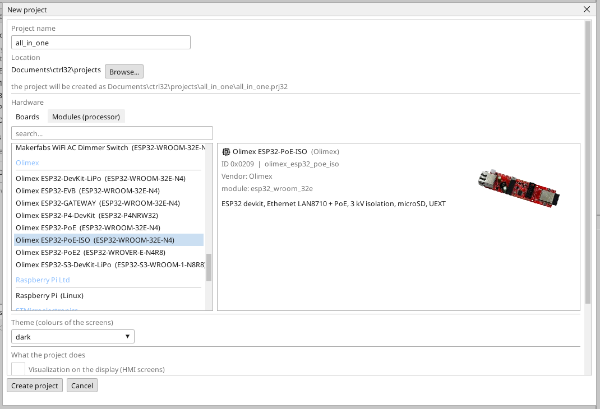
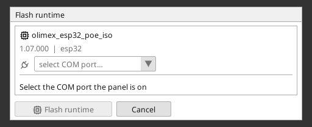
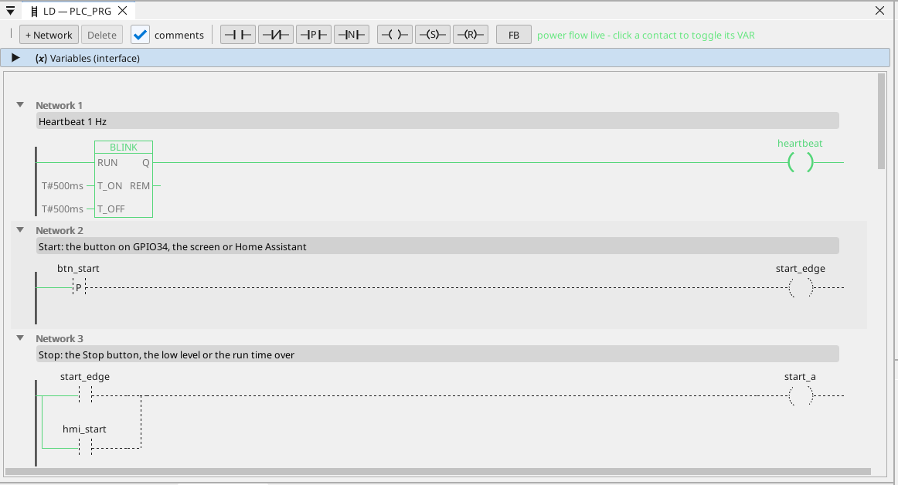

# ctrl32 runtime'ı kurun

Runtime, karttaki projenizi çalıştıran programdır - PLC döngüsü, ekranlar, iletişim. Karta bir kez yüklenir; bundan sonra projedeki her değişiklik, projeden başka hiçbir şeyi yeniden yazmayan bir yüklemedir.

## 1. Kartı bağlayın

Kartı USB kablosuyla PC'ye bağlayın. Kartta bir CH340T USB-UART dönüştürücüsü vardır. Windows 10 ve 11
sürücüsünü kendisi kurar; port görünmezse çip üreticisinin (WCH) CH340
sürücüsünü kurun ve kabloyu yeniden takın. Kart indirme moduna
kendiliğinden geçer - buton gerekmez.

## 2. Projeyi oluşturun

ctrl32 editörünü başlatın ve **New project** (Ctrl+N) seçin. Projenin **adını** yazın, kart listesinde (**Olimex** altında) **Olimex ESP32-PoE-ISO** seçin ve **Create project**'e basın.

Bunun yerine hazır örnekle başlamak için [all-in-one projesini](examples/all-in-one/README.tr.md) açın (**File → Open**).

## 3. Runtime'ı yazın

Araç çubuğunun port seçicisinde kartın COM portunu seçin, cihaz ağacında karta tıklayın ve **Flash runtime**'a basın. Editör runtime'ı yazar, geri okur ve doğrular; yaklaşık bir dakika sürer ve kart yeniden başlar. Bu bir kez yapılır - ve yalnızca editör yeni bir runtime hattı getirdiğinde yeniden.

## 4. Projeyi karta yükleyin

Araç çubuğundaki yükleme butonuna basın (F5). Editör projeyi derler, kartın etkin olmayan program yuvasına yazar, doğrular ve ancak ondan sonra geçiş yapar - başarısız bir yükleme çalışan programa dokunmaz.

## 5. Çalıştığını kontrol edin

Karttaki programı izlemek için **ONLINE**'a (port seçicinin yanındaki fiş simgesi) basın: iletken olan yeşildir, her değişken canlı değerini taşır. Elinizde kart yoksa aynı görünümü **simülasyon** verir (araç çubuğunda ONLINE'ın yanındaki buton).

Bir şey çalışmıyor mu? Bkz. [Sorun giderme](troubleshooting.tr.md).

*Ekran görüntüleri: ctrl32 editörü 1.07.*

---

[← Donanım ve kablolama](hardware.tr.md) | [Genel bakış](README.tr.md) | [Yapılandırma →](configure.tr.md)
