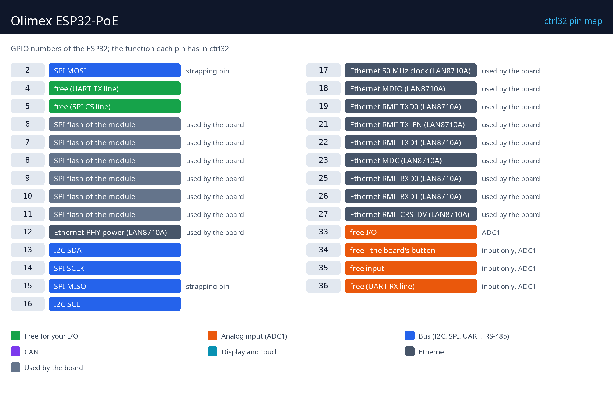

# Olimex ESP32-PoE

   

Olimex ESP32-PoE este o placă ESP32 open-source cu Ethernet și Power over Ethernet: un singur cablu de rețea o alimentează și îi duce legătura. Cu ctrl32 devine un PLC compact pentru un dulap sau o cutie de perete - un program ladder pe cip, pagina de operator servită oricărui browser din rețea (WEBview), Modbus TCP către contoare și module I/O și MQTT către Home Assistant sau orice broker.

**Potrivit pentru:**

- Un mic PLC într-un dulap, alimentat de la un switch PoE
- Un gateway Modbus TCP care citește contoare și le publică prin MQTT
- Automatizarea casei - o cameră sau o centrală termică pe un singur cablu

Pagina plăcii în catalog: [Olimex ESP32-PoE](https://ctrl32.com/hardware/boards/olimex-esp32-poe/)

## Ce poate face ctrl32 pe această placă

<!-- capabilities:start -->
| Funcție | Pe această placă | Note |
|---|---|---|
| Cip | ESP32 (ESP32-WROOM-32E-N4) |  |
| Memorie | 4 MB flash |  |
| Mărimea programului | 128 variabile, 32 alarme, 128 blocuri | verificat de editor înainte de descărcare |
| Intrări / ieșiri digitale | 6 GPIO libere | 3 dintre ele doar intrări |
| Intrări analogice | 4 pe cip (ADC1) | GPIO33, GPIO34, GPIO35, GPIO36 |
| Ethernet | da - LAN8710A |  |
| Power over Ethernet | IEEE 802.3af |  |
| Wi-Fi | Wi-Fi 2.4 GHz |  |
| CAN (TWAI) | 1 - pe pini liberi | necesită un transceiver extern |
| Modbus RTU (RS-485) | da - pe pini liberi | necesită un transceiver extern |
| Modbus TCP | client și server |  |
| MQTT | da | descoperire în Home Assistant |
| WEBview | da | pagina operatorului în orice browser |
| Afișaj / touch (HMI) | nu | pagina operatorului este WEBview |
| USB | Micro-USB (CH340T USB-UART) |  |
| Alimentare | 5 V USB, 3.7 V Li-Po / Li-Ion, PoE |  |
<!-- capabilities:end -->

### Ce nu este suportat

- Bluetooth - ESP32 îl are, ctrl32 nu îl folosește.
- Slotul microSD - ctrl32 ține programul și ecranele în flash-ul propriu al cipului.
- Intrarea de acumulator funcționează ca funcție proprie a plăcii; ctrl32 nu citește nivelul acumulatorului.

## Ghidul

| Pas | Pagină |
|---|---|
| 1 | [Hardware și cablare](hardware.ro.md) - de ce ai nevoie, alimentarea, harta pinilor |
| 2 | [Instalarea runtime-ului](install.ro.md) - editorul, placa, prima încărcare |
| 3 | [Configurare](configure.ro.md) - rețea, I/O, comunicație |
| 4 | [Proiecte exemplu](examples/README.ro.md) - tot ce face placa, gata de deschis |
| - | [Depanare](troubleshooting.ro.md) |

## Fișiere

| Fișier | Ce |
|---|---|
| [pinout/pinout.svg](pinout/pinout.svg) | harta pinilor, vectorial (și ca [PNG](pinout/pinout.png)) |
| [olimex-esp32-poe-schematic.pdf](schematics/olimex-esp32-poe-schematic.pdf) | ESP32-PoE schematic Rev M2 |
| [esp32-poe-revm2.zip](schematics/esp32-poe-revm2.zip) | KiCad project |
| [olimex-esp32-poe-user-manual.pdf](datasheets/olimex-esp32-poe-user-manual.pdf) | ESP32-PoE user manual |
| [olimex-esp32-poe.zip](3d/olimex-esp32-poe.zip) | Model 3D (STEP, arhivat zip) |
| [NOTICE](https://github.com/ctrl32/hardware/blob/main/NOTICE.md) | de unde provin fotografiile, schemele și modelele |

## Pașii următori

- [Documentația ctrl32](https://ctrl32.com/docs/) - editorul, limbajele, fiecare bloc
- [Descarcă editorul](https://ctrl32.com/download/)
- Toate plăcile testate
- Olimex ESP32-PoE-ISO - aceeași placă cu alimentare PoE izolată
- Olimex ESP32-POE2 - generația următoare

