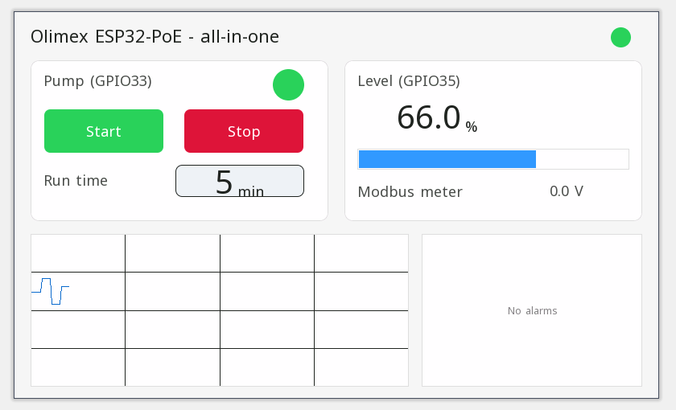

# Példaprojektek

Minden projekt megnyílik a ctrl32 szerkesztőben (**File → Open**), és változtatás nélkül fut a(z) Olimex ESP32-PoE panelen.

| | Projekt | Mit mutat |
|---|---|---|
|  | [All-in-one](all-in-one/README.hu.md) | Egy szivattyú, amelyet a panel gombja, a kezelőoldal és Home Assistant vezérel, szintbemenettel, futásidő-időzítővel, szintriasztással és egy Modbus TCP fogyasztásmérővel. |

---

[← Beállítás](../configure.hu.md) | [Áttekintés](../README.hu.md) | [Hibaelhárítás →](../troubleshooting.hu.md)
