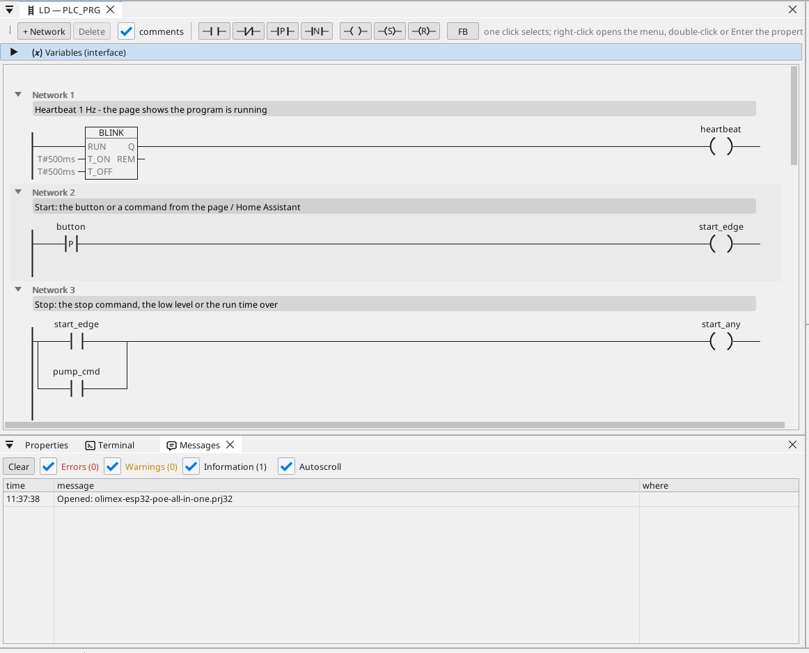

# All-in-one

Una pompa comandata dal pulsante della scheda, dalla pagina operatore e da Home Assistant, con un ingresso di livello, un timer di funzionamento, un allarme di livello e un contatore di energia Modbus TCP.

**Download:** [all-in-one.prj32](all-in-one.prj32) - aprilo nell'editor ctrl32 (**File → Open**).

## Cosa fa

Il programma è un piccolo controllore di pompa - la forma della
maggior parte delle macchine:

- **Start** arriva dal pulsante della scheda (BUT1), dal pulsante
  **Start** sulla pagina operatore o da Home Assistant tramite MQTT.
- **Stop** arriva dal pulsante **Stop**, da un livello basso o dallo
  scadere del tempo di funzionamento - l'autoritenuta spegne l'uscita
  su GPIO33.
- Il **livello** è un ingresso analogico su GPIO35 (da 0 a 3,3 V
  scalati da 0 a 100 %). Sotto il 10 % la pompa si ferma e scatta un
  allarme; sopra il 15 % può ripartire (isteresi).
- Il **tempo di funzionamento** si imposta sulla pagina in minuti e si
  conserva in caso di mancanza di corrente (una variabile ritentiva).
- Un contatore di energia **Modbus TCP** in rete fornisce la tensione
  di rete (registro 0, input register, unit 1 a 192.168.1.60 -
  cambialo con il tuo contatore). Sopra 253 V scatta un allarme.
- **CAN** (un transceiver su GPIO4 / GPIO36) invia ogni 100 ms il
  livello e lo stato della pompa nel frame 0x181 e riceve un setpoint
  in 0x201.
- **MQTT** pubblica il livello, lo stato della pompa e la tensione su
  un broker Home Assistant, che li trova da solo (discovery); la pompa
  si può avviare da Home Assistant.
- **WEBview** fornisce la pagina operatore - la pompa, il livello, il
  suo trend e gli allarmi - a qualsiasi browser della rete.

## Il programma

## La pagina operatore

## Aprirlo ed eseguirlo

1. Apri `all-in-one.prj32` nell'editor.
2. Cambia gli indirizzi (il dispositivo Modbus, il broker MQTT) con quelli della tua rete.
3. Avvia la **simulazione** (barra degli strumenti) per provarlo sul PC, oppure scaricalo sulla scheda - vedi [Installare il runtime](../../install.it.md).

## Cosa dovresti vedere

Con il potenziometro alzato, premi BUT1: il relè su GPIO33 si accende e
il LED della pompa sulla pagina si illumina. Abbassa il potenziometro
sotto il 10 %: la pompa si ferma e l'allarme compare nella tabella. In
Home Assistant la scheda compare con il suo livello, la pompa e la
tensione.

---

[← Progetti di esempio](../README.it.md) | [Panoramica](../../README.it.md)
