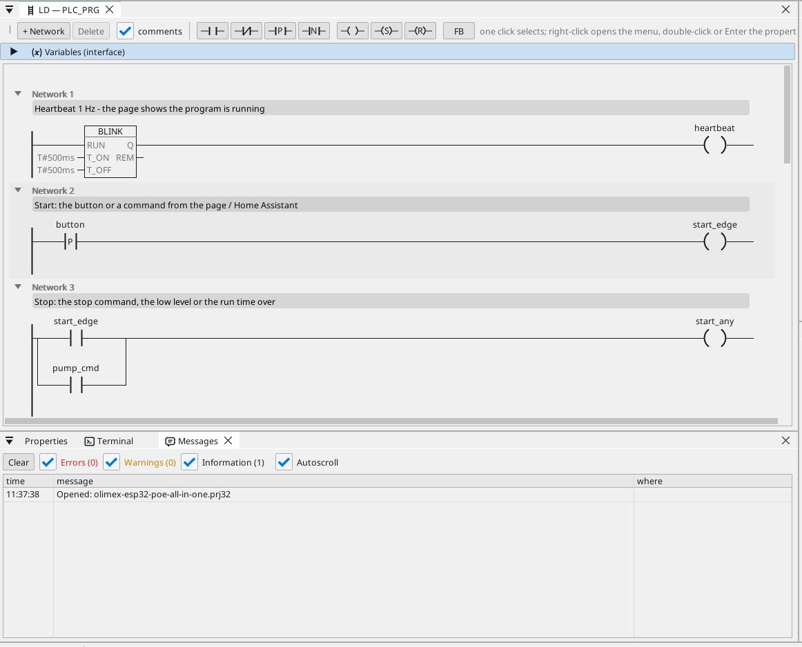

# All-in-one

A pump controlled by the board button, the operator page and Home Assistant, with a level input, a run timer, a level alarm and a Modbus TCP energy meter.

**Download:** [all-in-one.prj32](all-in-one.prj32) - open it in the ctrl32 editor (**File → Open**).

## What it does

The program is a small pump controller - the shape of most machines:

- **Start** comes from the board's button (BUT1), from the **Start**
  button on the operator page, or from Home Assistant over MQTT.
- **Stop** comes from the **Stop** button, from a low level or from
  the run time running out - the latch drops the output on GPIO33.
- The **level** is an analog input on GPIO35 (0 to 3.3 V scaled to 0
  to 100 %). Below 10 % the pump stops and an alarm is raised; above
  15 % it may start again (hysteresis).
- The **run time** is set on the page in minutes and kept through a
  power cut (a retained variable).
- A **Modbus TCP** energy meter on the network gives the mains voltage
  (register 0, input registers, unit 1 at 192.168.1.60 - change it to
  your meter). Above 253 V an alarm is raised.
- **MQTT** publishes the level, the pump state and the voltage to a
  Home Assistant broker, which finds them by itself (discovery); the
  pump can be started from Home Assistant.
- **WEBview** serves the operator page - the pump, the level, its
  trend and the alarms - to any browser on the network.

## The program

## The operator page

## Open and run it

1. Open `all-in-one.prj32` in the editor.
2. Change the addresses (the Modbus device, the MQTT broker) to the ones of your network.
3. Run the **simulation** (toolbar) to try it on the PC, or download it to the board - see [Install the runtime](../../install.md).

## What you should see

With the potentiometer turned up, press BUT1: the relay on GPIO33
switches on and the pump LED on the page lights. Turn the
potentiometer down below 10 %: the pump stops and the alarm appears in
the table. In Home Assistant the board shows up with its level, pump
and voltage.

---

[← Example projects](../README.md) | [Overview](../../README.md)
