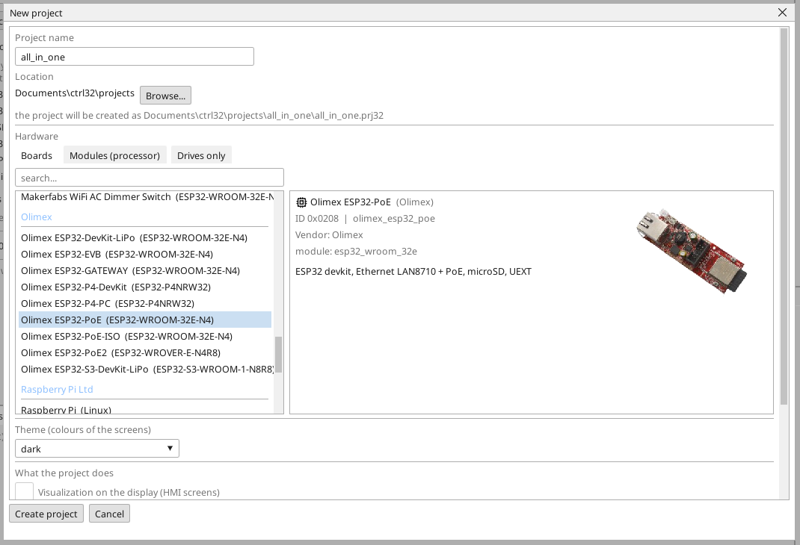
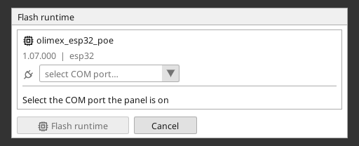
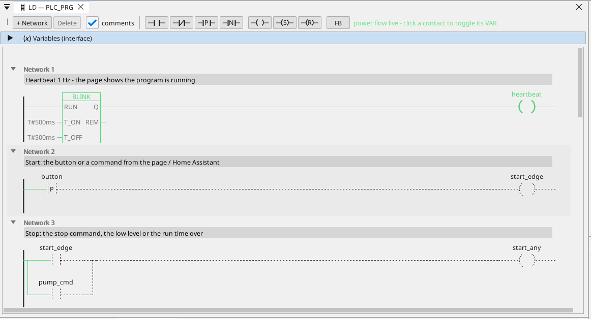

# Nahratie runtime ctrl32

Runtime je program v doske, ktorý vykonáva tvoj projekt - cyklus PLC, obrazovky, komunikáciu. Do dosky sa nahrá raz; potom je každá zmena projektu nahratím, ktoré prepíše len projekt.

## 1. Pripoj dosku

Pripoj dosku k PC káblom USB. Doska má prevodník USB-UART CH340T. Windows 10 a 11 si jeho ovládač
nainštalujú samy; ak sa port neobjaví, nainštaluj ovládač CH340 od výrobcu
čipu (WCH) a kábel pripoj znova. Doska sa do režimu nahrávania prepne
sama, netreba stláčať žiadne tlačidlo.

## 2. Vytvor projekt

Spusti editor ctrl32 a vyber **New project** (Ctrl+N). Zadaj **názov** projektu, v zozname dosiek vyber **Olimex ESP32-PoE** (pod **Olimex**) a stlač **Create project**.

Ak chceš začať hotovým príkladom, otvor [projekt all-in-one](examples/all-in-one/README.sk.md) (**File → Open**).

## 3. Zapíš runtime

Vyber COM port dosky vo výbere portu na paneli nástrojov, klikni na dosku v strome zariadení a stlač **Flash runtime**. Editor runtime zapíše, prečíta späť a overí; trvá to asi minútu a doska sa reštartuje. Robí sa to raz - a znova, až keď editor prinesie novú líniu runtime.

## 4. Nahraj projekt

Stlač tlačidlo nahrania na paneli nástrojov (F5). Editor projekt zostaví, zapíše ho do neaktívneho slotu programu v doske, overí ho a až potom prepne - nepodarené nahratie nechá bežiaci program nedotknutý.

## 5. Over, že beží

Stlač **ONLINE** (ikona zástrčky vedľa výberu portu) a sleduj program v doske: čo vedie, je zelené, každá premenná nesie živú hodnotu. Bez dosky ukáže to isté **simulácia** (tlačidlo na paneli vedľa ONLINE).

Niečo nejde? Pozri [Riešenie problémov](troubleshooting.sk.md).

*Screenshoty: editor ctrl32 1.07.*

---

[← Hardvér a zapojenie](hardware.sk.md) | [Prehľad](README.sk.md) | [Nastavenie →](configure.sk.md)
