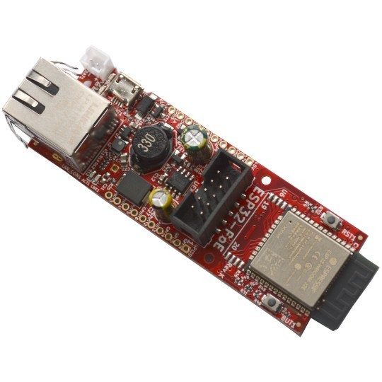
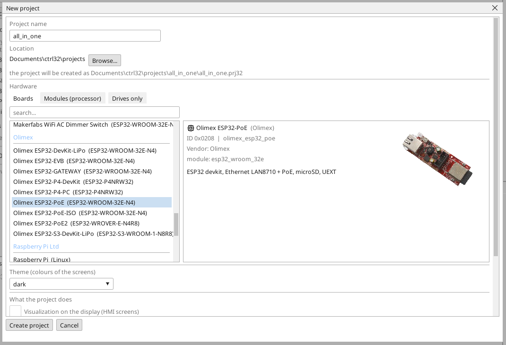
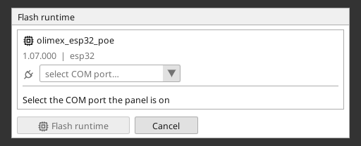
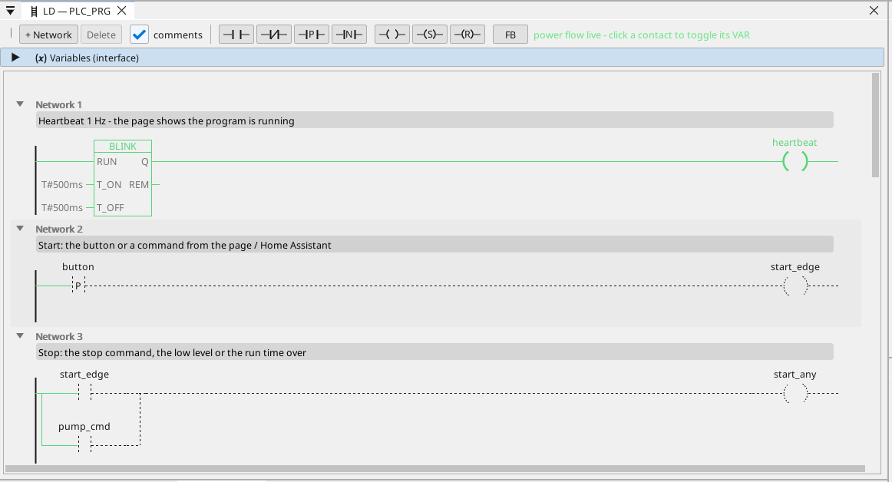

# Встановіть runtime ctrl32

Runtime - це програма на платі, яка виконує ваш проєкт: цикл PLC, екрани, зв'язок. Він записується на плату один раз; після цього кожна зміна проєкту - це завантаження, яке не перезаписує нічого, крім проєкту.

## 1. Підключіть плату

Підключіть плату до ПК кабелем USB. На платі є перетворювач USB-UART CH340T. Windows 10 і 11 самі
встановлюють його драйвер; якщо порт не з'являється, встановіть драйвер
CH340 від виробника чипа (WCH) і знову підключіть кабель. Плата сама
переходить у режим завантаження - натискати кнопку не потрібно.

## 2. Створіть проєкт

Запустіть редактор ctrl32 і виберіть **New project** (Ctrl+N). Введіть **назву** проєкту, виберіть **Olimex ESP32-PoE** у списку плат (у розділі **Olimex**) і натисніть **Create project**.

Щоб натомість почати з готового прикладу, відкрийте [проєкт all-in-one](examples/all-in-one/README.uk.md) (**File → Open**).

## 3. Запишіть runtime

Виберіть COM-порт плати у виборі порту на панелі інструментів, клацніть плату в дереві пристроїв і натисніть **Flash runtime**. Редактор записує runtime, читає його назад і перевіряє; це займає близько хвилини, і плата перезапускається. Це робиться один раз - і знову лише тоді, коли редактор приносить нову лінію runtime.

## 4. Завантажте проєкт

Натисніть кнопку завантаження на панелі інструментів (F5). Редактор збирає проєкт, записує його в неактивний слот програми плати, перевіряє і лише тоді перемикає - невдале завантаження не зачіпає запущену програму.

## 5. Перевірте, що все працює

Натисніть **ONLINE** (значок штекера біля вибору порту), щоб спостерігати за програмою на платі: те, що проводить, - зелене, кожна змінна має своє живе значення. Без плати той самий вигляд дає **симуляція** (кнопка поруч з ONLINE на панелі інструментів).

Щось не працює? Див. [Усунення несправностей](troubleshooting.uk.md).

*Знімки екрана: редактор ctrl32 1.07.*

---

[← Обладнання та підключення](hardware.uk.md) | [Огляд](README.uk.md) | [Налаштування →](configure.uk.md)
