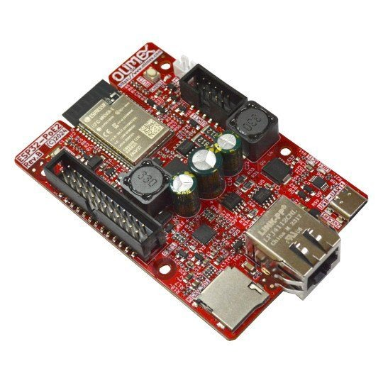

# Olimex ESP32-POE2

   

L'Olimex ESP32-POE2 est la génération suivante de l'ESP32-PoE : un ESP32 avec 8 Mo de PSRAM, Ethernet et Power over Ethernet IEEE 802.3at qui alimente aussi vos appareils de terrain - des sorties 24 V ou 12 V, 5 V et 3,3 V, jusqu'à 25 W depuis le câble réseau. Avec ctrl32, c'est un automate en armoire alimenté par un seul câble : logique ladder, WEBview, Modbus TCP et MQTT, avec la taille de programme complète d'un ESP32 classique avec PSRAM.

**Convient pour :**

- Un automate d'armoire qui alimente ses capteurs et un petit module relais par PoE
- Une passerelle Modbus TCP avec MQTT vers Home Assistant
- L'automatisation du bâtiment avec un câble par pièce

Page de la carte dans le catalogue : [Olimex ESP32-POE2](https://ctrl32.com/hardware/boards/olimex-esp32-poe2/)

## Ce que ctrl32 sait faire sur cette carte

<!-- capabilities:start -->
| Fonction | Sur cette carte | Remarques |
|---|---|---|
| Puce | ESP32 (ESP32-WROVER-E-N4R8) |  |
| Mémoire | 4 MB flash, 8 MB PSRAM |  |
| Taille du programme | 512 variables, 128 alarmes, 1024 blocs | vérifié par l'éditeur avant un téléchargement |
| Entrées / sorties numériques | 5 GPIO libres | 3 dont entrées seules |
| Entrées analogiques | 3 sur la puce (ADC1) | GPIO34, GPIO36, GPIO39 |
| Ethernet | oui - LAN8710A |  |
| Power over Ethernet | IEEE 802.3at |  |
| Wi-Fi | Wi-Fi 2.4 GHz |  |
| CAN (TWAI) | 1 - sur des broches libres | nécessite un transceiver externe |
| Modbus RTU (RS-485) | oui - sur des broches libres | nécessite un transceiver externe |
| Modbus TCP | client et serveur |  |
| MQTT | oui | découverte Home Assistant |
| WEBview | oui | la page opérateur dans tout navigateur |
| Écran / tactile (HMI) | non | la page opérateur est WEBview |
| USB | USB-C |  |
| Alimentation | 5 V USB, 3.7 V Li-Po / Li-Ion, PoE |  |
<!-- capabilities:end -->

### Ce qui n'est pas pris en charge

- Le Bluetooth - l'ESP32 l'a, ctrl32 ne l'utilise pas.
- Le lecteur microSD - ctrl32 garde le programme et les écrans dans la mémoire flash propre de la puce.
- L'entrée batterie fonctionne comme une fonction propre de la carte ; ctrl32 ne lit pas le niveau de la batterie.

## Le guide

| Étape | Page |
|---|---|
| 1 | [Matériel et câblage](hardware.fr.md) - ce dont vous avez besoin, l'alimentation, le brochage |
| 2 | [Installer le runtime](install.fr.md) - l'éditeur, la carte, le premier chargement |
| 3 | [Configurer](configure.fr.md) - réseau, E/S, communication |
| 4 | [Projets d'exemple](examples/README.fr.md) - tout ce que fait la carte, prêt à ouvrir |
| - | [Dépannage](troubleshooting.fr.md) |

## Fichiers

-

## Étapes suivantes

- [documentation ctrl32](https://ctrl32.com/docs/) - l'éditeur, les langages, chaque bloc
- [Télécharger l'éditeur](https://ctrl32.com/download/)
- [Toutes les cartes testées](../../README.fr.md)
- [Olimex ESP32-PoE](../olimex-esp32-poe/README.fr.md) - la première génération
- [Olimex ESP32-PoE-ISO](../olimex-esp32-poe-iso/README.fr.md) - avec une alimentation PoE isolée

