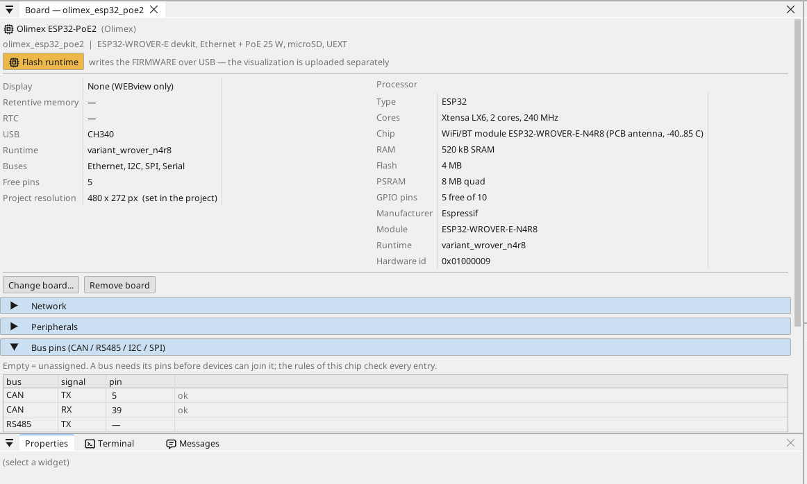

# A panel beállítása

## A panel oldala

Kattints duplán a panelre az eszközfában. Az oldal megmutatja, mi van a panelen, és minden lábat: egy szabad láb egy kattintással kap változót - bemenetet, kimenetet, vagy analógképes lábon analóg bemenetet.

## Hálózat

Az Ethernet port magától elindul. Alapértelmezés szerint a panel a
routertől kap címet (DHCP), és a nevén jelentkezik a hálózaton
(`<projekt>.local`). Fix címet a panel oldalának **Network** szakaszában
adhatsz meg.

**Wi-Fi.** Az ESP32-nek Wi-Fi-je is van (nyisd meg a **WiFi** elemet az
eszközfában). Kapcsolószekrényben a kábel a jobb út: a tápot is viszi, és
a panelen semmit sem kell hozzá beállítani.

## Bemenetek, kimenetek és változók

A program minden jele egy **változó**. Egy lábhoz rendelt változó olvassa vagy vezérli a lábat; egy analóg változó megmondja, mi van rákötve (feszültség, 4-20 mA, termisztor), és mi a tartománya mértékegységben.

## Kommunikáció

**Modbus TCP.** A hálózat egy eszközét az **Ethernet → Modbus TCP master** alatt adod hozzá; a regiszterei változókká válnak.

**Modbus RTU / RS-485.** A panelen nincs RS-485 adó-vevő: tegyél egy 3,3 V-os adó-vevő modult szabad lábakra (TX, RX és a DE irányláb), és add meg őket a panel oldalán (Bus pins) - a ctrl32 ezután Modbus RTU master vagy slave azon a vonalon. A hálózat Modbus TCP eszközeihez semmi sem kell.

**CAN.** A(z) ESP32 egy CAN vezérlővel (TWAI) rendelkezik. A panelen nincs CAN adó-vevő: tegyél egy 3,3 V-os adó-vevő modult két szabad lábra, és add meg őket a panel oldalán (Bus pins) - ezután CANopen eszközök, nyers CAN keretek és a járműbuszok (J1939) futnak rajta.

**MQTT.** A panel a kiválasztott változókat egy brókernek teszi közzé; Home Assistant módban a bróker magától megtalálja őket, és egy *write* jelölésű változó onnan is beállítható.

## WEBview

A panel a kezelőoldalát a hálózat bármely böngészőjének kiszolgálja - nyisd meg a panel címét. Az oldalt a szerkesztőben úgy rajzolod meg, mint egy képernyőt.

---

[← A runtime telepítése](install.hu.md) | [Áttekintés](README.hu.md) | [Példaprojektek →](examples/README.hu.md)
