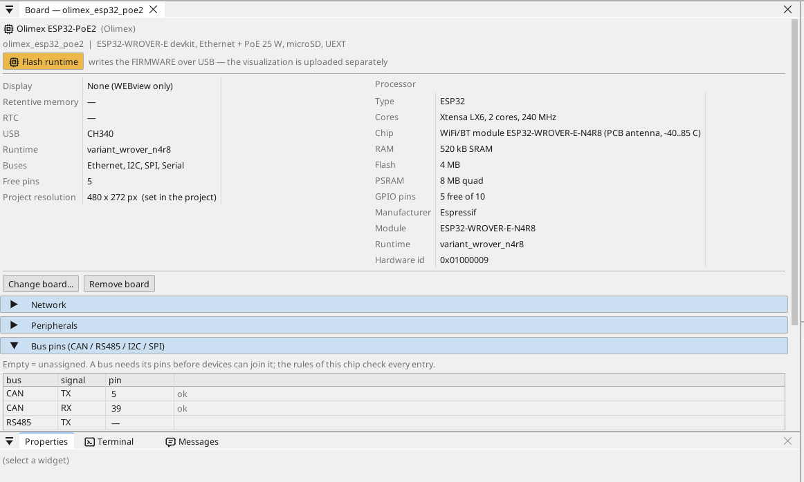

# Configurare la scheda

## La pagina della scheda

Fai doppio clic sulla scheda nell'albero dei dispositivi. La pagina mostra cosa porta la scheda e ogni pin: un pin libero riceve una variabile con un clic - un ingresso, un'uscita o, su un pin con funzione analogica, un ingresso analogico.

## Rete

La porta Ethernet si avvia da sola. Per impostazione predefinita la scheda
prende l'indirizzo dal tuo router (DHCP) e si annuncia in rete con il suo
nome (`<progetto>.local`). Per darle un indirizzo fisso, apri la pagina
della scheda e la sua sezione **Network**.

**Wi-Fi.** L'ESP32 ha anche il Wi-Fi (apri **WiFi** nell'albero dei
dispositivi). In un quadro elettrico il cavo è la via migliore: porta
anche l'alimentazione, e sulla scheda non c'è nulla da impostare.

## Ingressi, uscite e variabili

Ogni segnale del programma è una **variabile**. Una variabile su un pin legge o pilota il pin; una variabile analogica dice cosa vi è collegato (una tensione, 4-20 mA, un termistore) e il suo campo in unità.

## Comunicazione

**Modbus TCP.** Un dispositivo in rete si aggiunge sotto **Ethernet → Modbus TCP master**; i suoi registri diventano variabili.

**Modbus RTU / RS-485.** La scheda non ha un transceiver RS-485: collega un modulo transceiver a 3,3 V a pin liberi (TX, RX e il pin di direzione DE) e indicali nella pagina della scheda (Bus pins) - ctrl32 è allora master o slave Modbus RTU su quella linea. I dispositivi Modbus TCP in rete non richiedono nulla.

**CAN.** Il ESP32 ha un controller CAN (TWAI). La scheda non ha un transceiver CAN: collega un modulo transceiver a 3,3 V a due pin liberi e indicali nella pagina della scheda (Bus pins) - i dispositivi CANopen, i frame CAN grezzi e i bus veicolari (J1939) funzionano allora su di esso.

**MQTT.** La scheda pubblica le variabili scelte su un broker; nella modalità Home Assistant il broker le trova da solo, e una variabile contrassegnata *write* si può impostare da lì.

## WEBview

La scheda fornisce la sua pagina operatore a qualsiasi browser della rete - apri l'indirizzo della scheda. La pagina si disegna nell'editor come una schermata.

---

[← Installare il runtime](install.it.md) | [Panoramica](README.it.md) | [Progetti di esempio →](examples/README.it.md)
