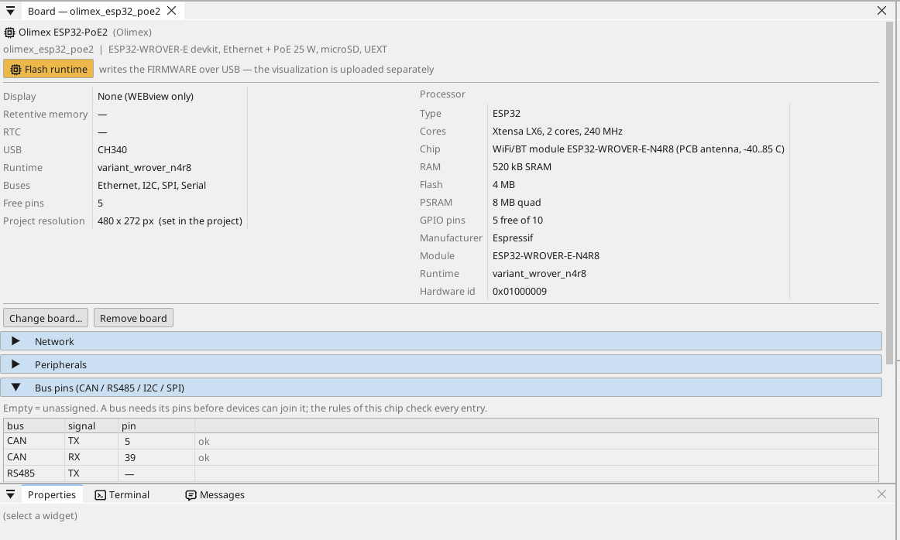
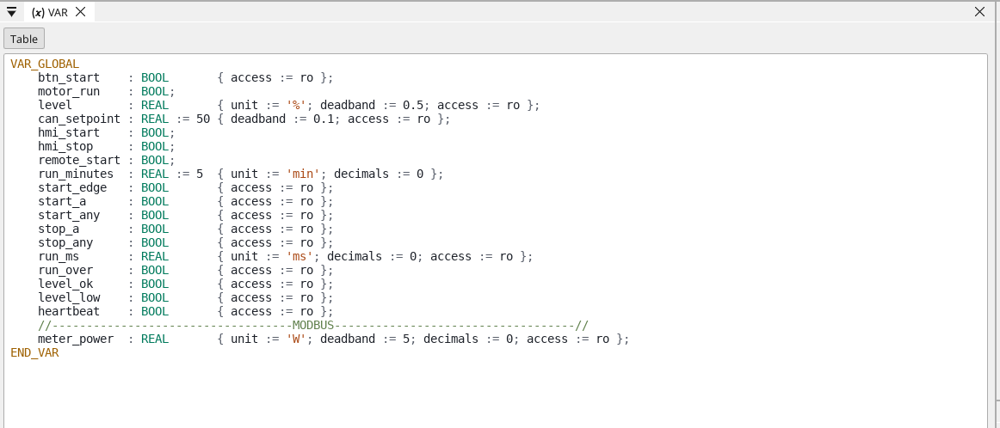
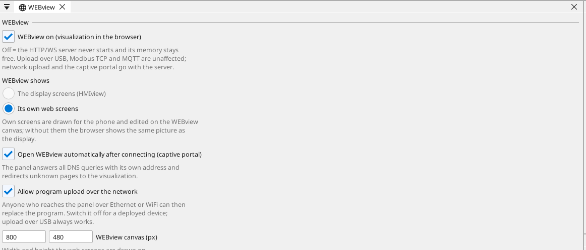

# Налаштуйте плату

## Сторінка плати

Двічі клацніть плату в дереві пристроїв. Сторінка показує, що є на платі, і кожен пін: вільний пін отримує змінну одним клацанням - вхід, вихід або, на піні з аналоговою функцією, аналоговий вхід.

## Мережа

Порт Ethernet запускається сам. За замовчуванням плата отримує адресу від
вашого маршрутизатора (DHCP) і оголошує себе в мережі під своїм іменем
(`<проєкт>.local`). Щоб задати фіксовану адресу, відкрийте сторінку плати
та її розділ **Network**.

**Wi-Fi.** ESP32 має також Wi-Fi (відкрийте **WiFi** у дереві пристроїв).
У шафі кабель - кращий шлях: він передає й живлення, і на платі для цього
нічого не треба налаштовувати.

## Входи, виходи та змінні

Кожен сигнал програми - це **змінна**. Змінна на піні читає пін або керує ним; аналогова змінна каже, що до неї підключено (напруга, 4-20 мА, термістор), і її діапазон в одиницях.

## Зв'язок

**Modbus TCP.** Пристрій у мережі додається в **Ethernet → Modbus TCP master**; його регістри стають змінними.

**Modbus RTU / RS-485.** На платі немає трансивера RS-485: підключіть модуль трансивера 3,3 В до вільних пінів (TX, RX і пін напрямку DE) і назвіть їх на сторінці плати (Bus pins) - тоді ctrl32 є Modbus RTU master або slave на цій лінії. Пристроям Modbus TCP у мережі нічого не потрібно.

**CAN.** ESP32 має один CAN-контролер (TWAI). На платі немає CAN-трансивера: підключіть модуль трансивера 3,3 В до двох вільних пінів і назвіть їх на сторінці плати (Bus pins) - тоді на ньому працюють пристрої CANopen, сирі CAN-кадри та автомобільні шини (J1939).

**MQTT.** Плата публікує вибрані змінні на брокер; у режимі Home Assistant брокер сам їх знаходить, а змінну з позначкою *write* можна задати звідти.

## WEBview

Плата надає свою сторінку оператора будь-якому браузеру в мережі - відкрийте адресу плати. Сторінка малюється в редакторі як екран.

---

[← Встановлення runtime](install.uk.md) | [Огляд](README.uk.md) | [Приклади проєктів →](examples/README.uk.md)
