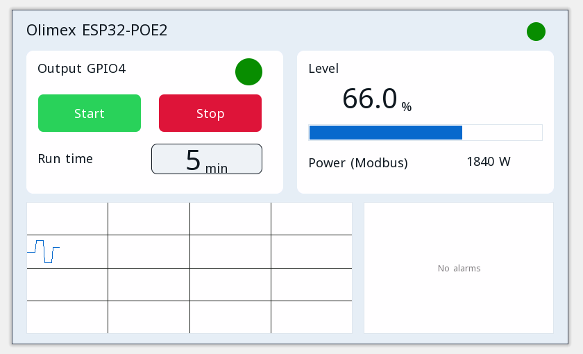

# Példaprojektek

Minden projekt megnyílik a ctrl32 szerkesztőben (**File → Open**), és változtatás nélkül fut a(z) Olimex ESP32-POE2 panelen.

| | Projekt | Mit mutat |
|---|---|---|
|  | [All-in-one](all-in-one/README.hu.md) | Egy motorkimenet start / stop vezérléssel, futásidővel, analóg szinttel, CAN keretekkel, Modbus TCP mérővel, MQTT-vel és kezelőoldallal a böngészőben. |

---

[← Beállítás](../configure.hu.md) | [Áttekintés](../README.hu.md) | [Hibaelhárítás →](../troubleshooting.hu.md)
