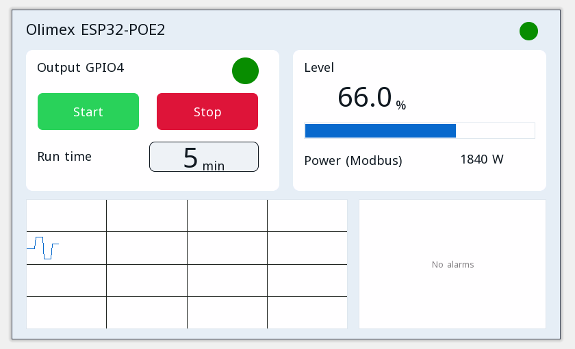

# Progetti di esempio

Ogni progetto si apre nell'editor ctrl32 (**File → Open**) e funziona così com'è sulla Olimex ESP32-POE2.

| | Progetto | Cosa mostra |
|---|---|---|
|  | [All-in-one](all-in-one/README.it.md) | Un'uscita motore con start / stop, un timer di funzionamento, un livello analogico, frame CAN, un contatore Modbus TCP, MQTT e la pagina operatore in un browser. |

---

[← Configurare](../configure.it.md) | [Panoramica](../README.it.md) | [Risoluzione dei problemi →](../troubleshooting.it.md)
