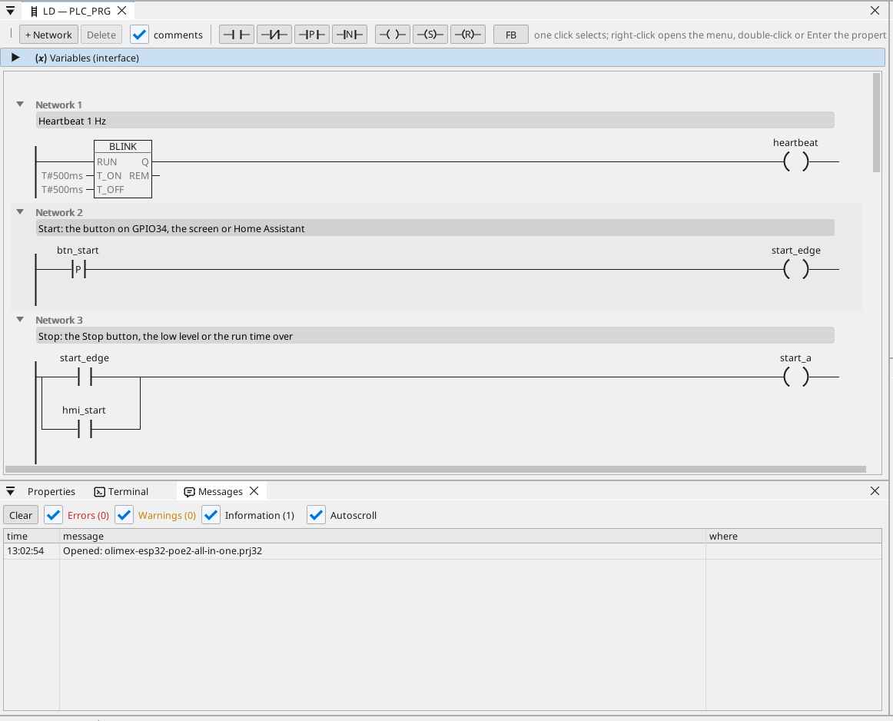
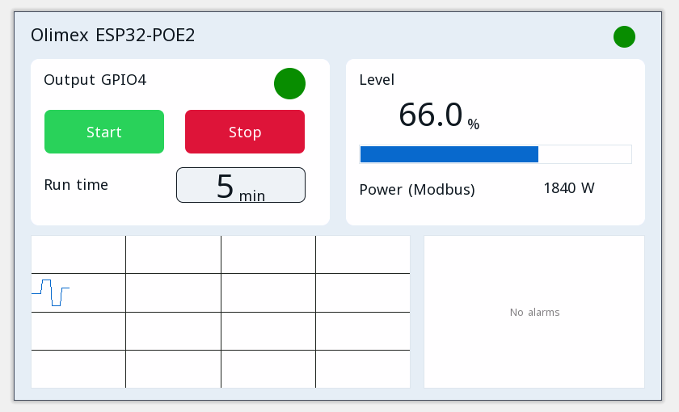

# All-in-one

Wyjście silnika ze start / stop, czasem pracy, poziomem analogowym, ramkami CAN, licznikiem Modbus TCP, MQTT i stroną operatora w przeglądarce.

**Pobieranie:** [all-in-one.prj32](all-in-one.prj32) - otwórz go w edytorze ctrl32 (**File → Open**).

## Co robi

Program to mały sterownik maszyny - kształt większości maszyn:

- **Start** pochodzi od przycisku na GPIO34, od **Start** na stronie operatora lub z Home Assistant przez MQTT.
- **Stop** pochodzi od **Stop**, od niskiego poziomu lub od upływu czasu pracy - podtrzymanie wyłącza wyjście na **GPIO4**.
- **Czas pracy** ustawia się w minutach i jest zachowywany po zaniku zasilania.
- **Poziom** to wejście analogowe na **GPIO36** (0 do 3,3 V przeskalowane na 0 do 100 %); poniżej 10 % wyjście się zatrzymuje i zgłaszany jest alarm, powyżej 15 % może ruszyć ponownie.
- **CAN** co 100 ms wysyła poziom i stan wyjścia w ramce 0x181 i odbiera wartość zadaną w ramce 0x201.
- Licznik energii **Modbus TCP** w sieci podaje pobór mocy (192.168.1.60 - zmień na adres swojego licznika).
- **MQTT** publikuje wartości do brokera Home Assistant, który sam je znajduje; wyjście można też uruchomić z Home Assistant.
- **WEBview** udostępnia stronę operatora każdej przeglądarce w sieci.

## Program

## Strona operatora

## Otwórz i uruchom

1. Otwórz `all-in-one.prj32` w edytorze.
2. Zmień adresy (urządzenia Modbus, brokera MQTT) na adresy swojej sieci.
3. Uruchom **symulację** (pasek narzędzi), aby wypróbować projekt na PC, albo wgraj go na płytkę - zobacz [Instalacja runtime](../../install.pl.md).

## Co powinieneś zobaczyć

Naciśnij przycisk na GPIO34: wyjście na GPIO4 włącza się, a jego dioda na stronie świeci. Po upływie czasu pracy wyłącza się samo, a gdy poziom spadnie poniżej 10 %, alarm pojawia się w tabeli. W Home Assistant płytka pojawia się ze swoimi wartościami.

---

[← Przykładowe projekty](../README.pl.md) | [Przegląd](../../README.pl.md)
