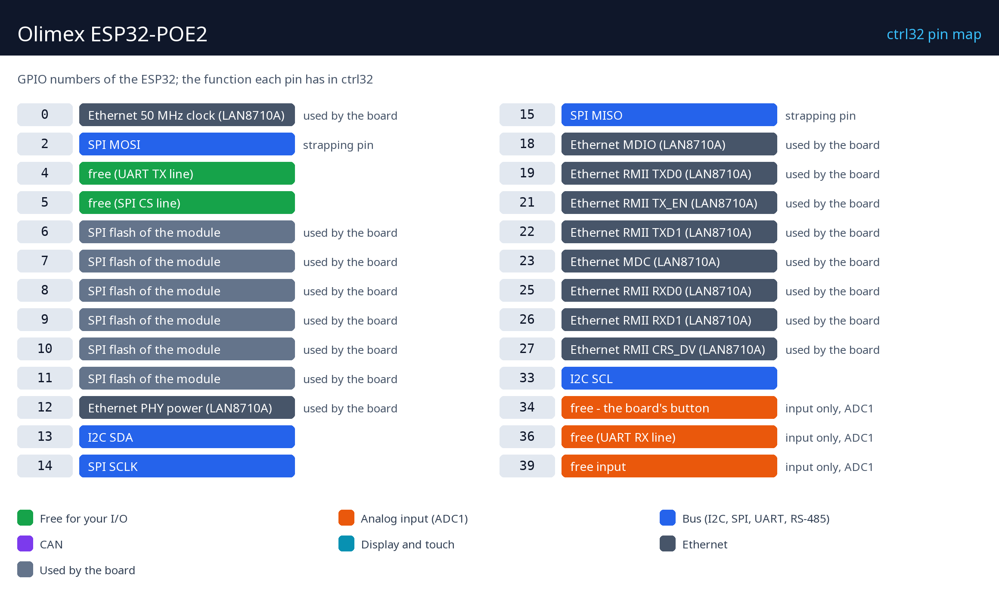

# Hardware und Verdrahtung

## Was Sie brauchen

- Das Olimex ESP32-POE2.
- Ein USB-C-Datenkabel - für das erste Aufspielen der Runtime.
- Spannungsversorgung: ein PoE-Switch / Injektor (IEEE 802.3at, Klasse 4 für die vollen 25 W) oder ein 5-V-USB-Netzteil.
- Ein Ethernet-Kabel und ein freier Port in Ihrem Netzwerk.
- Ein PC mit dem [ctrl32-Editor](https://ctrl32.com/download/) (Windows).
- Optional, für das Beispiel all-in-one: der Taster BUT1 ist auf dem Board; ein Relaismodul oder eine LED an GPIO4 (UEXT); ein Potentiometer (10 k) zwischen 3,3 V und GND mit dem Schleifer an GPIO36; ein 3,3-V-CAN-Transceiver an GPIO5 (TX) / GPIO39 (RX).

## Spannungsversorgung

| Quelle | Wo | Hinweis |
|---|---|---|
| PoE | die Ethernet-Buchse | IEEE 802.3at Klasse 4, bis zu 25 W |
| USB 5 V | der USB-C-Anschluss | der Weg für das erste Aufspielen |
| Li-Po-Akku | der Akkuanschluss | wird auf dem Board geladen |

Über Ethernet versorgt, speist das Board externe Schaltungen: **24 V /
0,75 A oder 12 V / 1,5 A** (eine Steckbrücke wählt), **5 V / 1,5 A** und
**3,3 V / 1 A**, insgesamt 25 W.

!!! danger "USB und PoE niemals gleichzeitig anschließen"
    Das ESP32-POE2 ist von der Ethernet-Versorgung **nicht galvanisch
    getrennt**. Spielen Sie die Runtime über USB bei abgezogenem
    Ethernet-Kabel auf (oder an einem Port ohne PoE) und betreiben Sie das
    Board erst danach an PoE.

## Pin-Belegung

| GPIO | Funktion in ctrl32 | Hinweis |
|---|---|---|
| 0 | Ethernet 50 MHz clock (LAN8710A) | ⚠ vom Board belegt |
| 2 | SPI MOSI | ⚠ Strapping-Pin |
| 4 | free (UART TX line) |  |
| 5 | free (SPI CS line) |  |
| 6 | SPI-Flash des Moduls | ⚠ vom Board belegt |
| 7 | SPI-Flash des Moduls | ⚠ vom Board belegt |
| 8 | SPI-Flash des Moduls | ⚠ vom Board belegt |
| 9 | SPI-Flash des Moduls | ⚠ vom Board belegt |
| 10 | SPI-Flash des Moduls | ⚠ vom Board belegt |
| 11 | SPI-Flash des Moduls | ⚠ vom Board belegt |
| 12 | Ethernet PHY power (LAN8710A) | ⚠ vom Board belegt |
| 13 | I2C SDA |  |
| 14 | SPI SCLK |  |
| 15 | SPI MISO | ⚠ Strapping-Pin |
| 18 | Ethernet MDIO (LAN8710A) | ⚠ vom Board belegt |
| 19 | Ethernet RMII TXD0 (LAN8710A) | ⚠ vom Board belegt |
| 21 | Ethernet RMII TX_EN (LAN8710A) | ⚠ vom Board belegt |
| 22 | Ethernet RMII TXD1 (LAN8710A) | ⚠ vom Board belegt |
| 23 | Ethernet MDC (LAN8710A) | ⚠ vom Board belegt |
| 25 | Ethernet RMII RXD0 (LAN8710A) | ⚠ vom Board belegt |
| 26 | Ethernet RMII RXD1 (LAN8710A) | ⚠ vom Board belegt |
| 27 | Ethernet RMII CRS_DV (LAN8710A) | ⚠ vom Board belegt |
| 33 | I2C SCL |  |
| 34 | frei - der Taster des Boards | ⚠ nur Eingang, ADC1 |
| 36 | free (UART RX line) | ⚠ nur Eingang, ADC1 |
| 39 | frei - Eingang | ⚠ nur Eingang, ADC1 |

Die freien Pins liegen auf den **EXT**-Stiftleisten und auf dem
**UEXT**-Steckverbinder. GPIO34 bis GPIO39 sind reine Eingänge. Das PSRAM
des Moduls belegt GPIO16 / GPIO17, deshalb läuft der Ethernet-Takt auf
GPIO0 und I2C nutzt GPIO13 / GPIO33.

## Sicherheit

- Das Board ist nicht für Sicherheitsfunktionen vorgesehen. Ein Not-Halt,
  ein Türschalter oder ein Lichtvorhang wird in Hardware verdrahtet, niemals
  über ein Programm.
- Die GPIO-Pins arbeiten mit 3,3 V. Ein 24-V-Eingang braucht einen
  Optokoppler oder einen Pegelwandler; eine Relaisspule braucht einen
  Treiber (ein Relaismodul hat einen).

---

[← Übersicht](README.de.md) | [Übersicht](README.de.md) | [Runtime installieren →](install.de.md)
