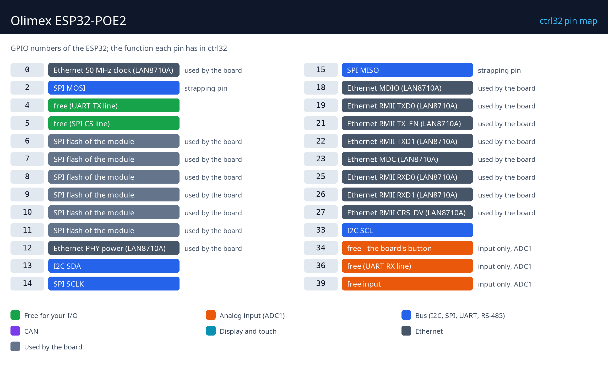

# Hardware and wiring

## What you need

- The Olimex ESP32-POE2.
- A USB-C data cable - for the first upload of the runtime.
- For power: a PoE switch / injector (IEEE 802.3at, class 4 for the full 25 W), or a 5 V USB supply.
- An Ethernet cable and a free port on your network.
- A PC with the [ctrl32 editor](https://ctrl32.com/download/) (Windows).
- Optional, for the all-in-one example: the button BUT1 is on the board; a relay module or an LED on GPIO4 (UEXT); a potentiometer (10 k) between 3.3 V and GND with its wiper on GPIO36.

## Power

| Source | Where | Note |
|---|---|---|
| PoE | the Ethernet jack | IEEE 802.3at class 4, up to 25 W |
| USB 5 V | the USB-C connector | the road for the first upload |
| Li-Po battery | the battery connector | charged on board |

Powered over Ethernet, the board feeds external circuits: **24 V / 0.75 A
or 12 V / 1.5 A** (a jumper selects), **5 V / 1.5 A** and **3.3 V / 1 A**,
25 W in total.

!!! danger "Never connect USB and PoE at the same time"
    The ESP32-POE2 is **not galvanically isolated** from the Ethernet
    supply. Upload the runtime over USB with the Ethernet cable unplugged
    (or from a non-PoE port), then run the board on PoE.

## Pin map

| GPIO | Function in ctrl32 | Note |
|---|---|---|
| 0 | Ethernet 50 MHz clock (LAN8710A) | ⚠ used by the board |
| 2 | SPI MOSI | ⚠ strapping pin |
| 4 | free (UART TX line) |  |
| 5 | free (SPI CS line) |  |
| 6 | SPI flash of the module | ⚠ used by the board |
| 7 | SPI flash of the module | ⚠ used by the board |
| 8 | SPI flash of the module | ⚠ used by the board |
| 9 | SPI flash of the module | ⚠ used by the board |
| 10 | SPI flash of the module | ⚠ used by the board |
| 11 | SPI flash of the module | ⚠ used by the board |
| 12 | Ethernet PHY power (LAN8710A) | ⚠ used by the board |
| 13 | I2C SDA |  |
| 14 | SPI SCLK |  |
| 15 | SPI MISO | ⚠ strapping pin |
| 18 | Ethernet MDIO (LAN8710A) | ⚠ used by the board |
| 19 | Ethernet RMII TXD0 (LAN8710A) | ⚠ used by the board |
| 21 | Ethernet RMII TX_EN (LAN8710A) | ⚠ used by the board |
| 22 | Ethernet RMII TXD1 (LAN8710A) | ⚠ used by the board |
| 23 | Ethernet MDC (LAN8710A) | ⚠ used by the board |
| 25 | Ethernet RMII RXD0 (LAN8710A) | ⚠ used by the board |
| 26 | Ethernet RMII RXD1 (LAN8710A) | ⚠ used by the board |
| 27 | Ethernet RMII CRS_DV (LAN8710A) | ⚠ used by the board |
| 33 | I2C SCL |  |
| 34 | free - the board's button | ⚠ input only, ADC1 |
| 36 | free (UART RX line) | ⚠ input only, ADC1 |
| 39 | free input | ⚠ input only, ADC1 |

The free pins sit on the **EXT** headers and on the **UEXT** connector.
GPIO34 to GPIO39 are inputs only. The module's PSRAM takes GPIO16 / GPIO17,
so the Ethernet clock runs on GPIO0 and I2C uses GPIO13 / GPIO33.

## Safety

- The board is not intended for safety functions. An emergency stop, a
  door switch or a light curtain is wired in hardware, never through a
  program.
- The GPIO pins are 3.3 V. A 24 V input needs an opto-coupler or a level
  shifter; a relay coil needs a driver (a relay module has one).

---

[← Overview](README.md) | [Overview](README.md) | [Install the runtime →](install.md)
