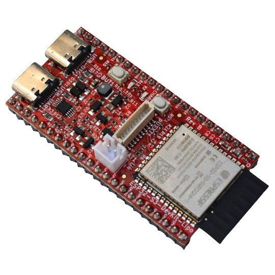
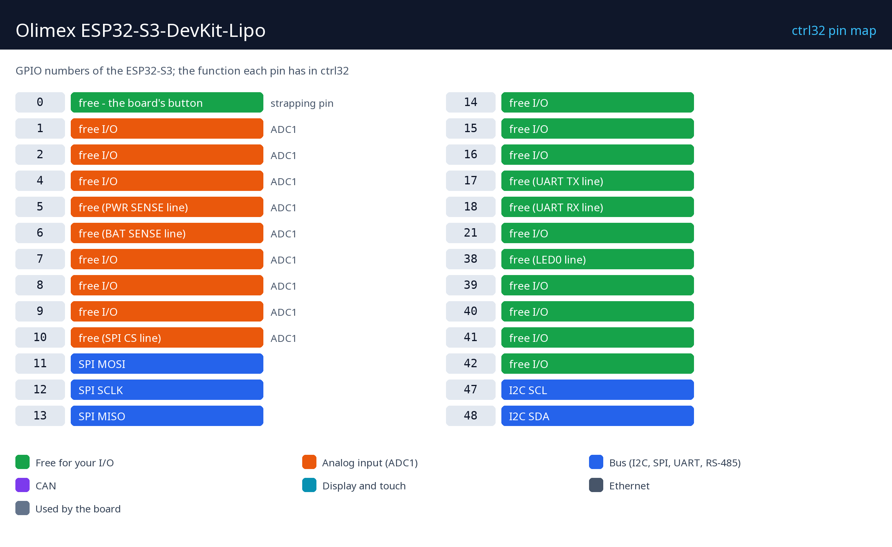

# Olimex ESP32-S3-DevKit-Lipo

  

Olimex ESP32-S3-DevKit-Lipo; 8 MB flash, 8 MB PSRAM, Wi-Fi, iki USB-C portu ve bir Li-Po şarj devresine sahip, açık kaynaklı bir ESP32-S3 kartıdır. PSRAM'li S3, ctrl32'nin referans çipidir: tam program boyutunda bir merdiven programı, her tarayıcıda operatör sayfası (WEBview), Modbus TCP ve TLS'li MQTT - hepsi Wi-Fi üzerinden.

**Şunlar için uygun:**

- Büyümeye yer olan bir Wi-Fi PLC - 512 değişken, bulut broker'ına TLS
- Elektrik kesintisinde çalışmaya devam eden, pil destekli bir kontrolcü
- ESP32-S3 üzerinde kendi kartınızın geliştirilmesi

Kataloğda kartın sayfası: [Olimex ESP32-S3-DevKit-Lipo](https://ctrl32.com/hardware/boards/olimex-esp32-s3-devkit-lipo/)

## ctrl32 bu kartta neler yapabilir

<!-- capabilities:start -->
| Özellik | Bu kartta | Notlar |
|---|---|---|
| Çip | ESP32-S3 (ESP32-S3-WROOM-1-N8R8) |  |
| Bellek | 8 MB flash, 8 MB PSRAM |  |
| Program boyutu | 512 değişken, 128 alarm, 1024 blok | editör yüklemeden önce kontrol eder |
| Dijital girişler / çıkışlar | 21 boş GPIO | pin haritasına bakın |
| Analog girişler | 9 çip üzerinde (ADC1) | GPIO1, GPIO2, GPIO4, GPIO5, GPIO6, GPIO7, GPIO8, GPIO9, GPIO10 |
| Ethernet | hayır |  |
| Wi-Fi | Wi-Fi 2.4 GHz |  |
| CAN (TWAI) | 1 - boş pinlerde | harici bir alıcı-verici gerektirir |
| Modbus RTU (RS-485) | evet - boş pinlerde | harici bir alıcı-verici gerektirir |
| Modbus TCP | istemci ve sunucu |  |
| MQTT | evet (TLS de) | Home Assistant keşfi (discovery) |
| WEBview | evet | her tarayıcıda operatör sayfası |
| Ekran / dokunmatik (HMI) | hayır | operatör sayfası WEBview'dur |
| USB | USB-C (CH340X USB-UART, Native USB) |  |
| Besleme | 5 V USB, 3.7 V Li-Po / Li-Ion |  |
<!-- capabilities:end -->

### Neler desteklenmez

- Bluetooth - ESP32-S3'te var, ctrl32 kullanmaz.
- Pil ve besleme algılama girişleri (GPIO5 / GPIO6) ctrl32'de boş pinlerdir, bir pil göstergesi değil.

## Kılavuz

| Adım | Sayfa |
|---|---|
| 1 | [Donanım ve kablolama](hardware.tr.md) - neye ihtiyacınız var, besleme, pin haritası |
| 2 | [Runtime'ı kurun](install.tr.md) - editör, kart, ilk yükleme |
| 3 | [Yapılandırma](configure.tr.md) - ağ, G/Ç, iletişim |
| 4 | [Örnek projeler](examples/README.tr.md) - kartın yaptığı her şey, açılmaya hazır |
| - | [Sorun giderme](troubleshooting.tr.md) |

## Dosyalar

-

## Sonraki adımlar

- [ctrl32 belgeleri](https://ctrl32.com/docs/) - editör, diller, her blok
- [Editörü indirin](https://ctrl32.com/download/)
- [Tüm test edilmiş kartlar](../../README.tr.md)
- [Olimex ESP32-DevKit-LiPo](../olimex-esp32-devkit-lipo/README.tr.md) - klasik ESP32 sürümü

