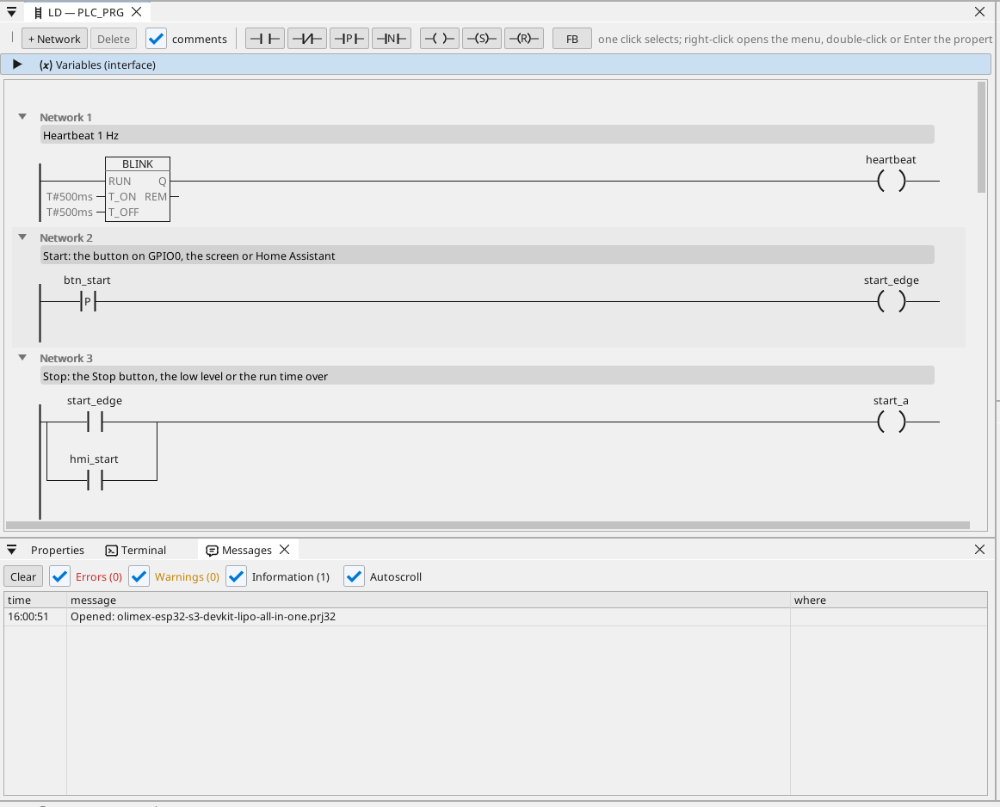
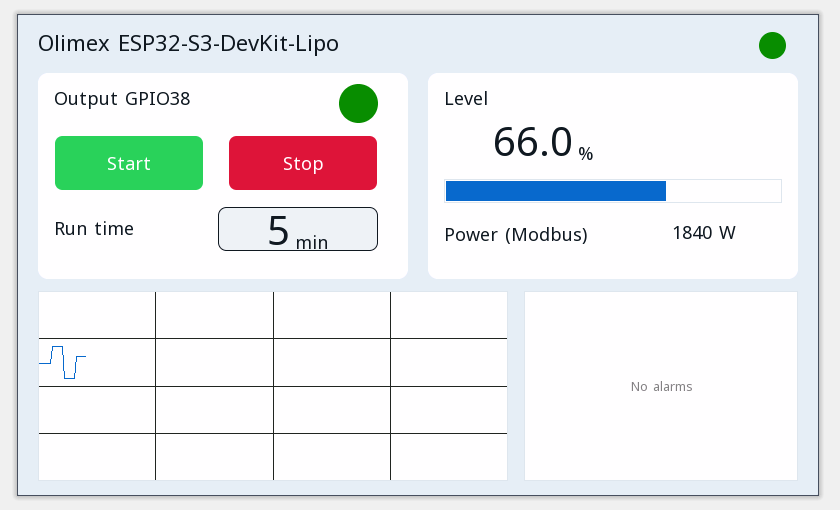

# All-in-one

O ieșire de motor cu start / stop, un temporizator de funcționare, un nivel analogic, o temperatură Modbus RTU, cadre CAN, un contor Modbus TCP, MQTT și pagina operatorului într-un browser.

**Descărcare:** [all-in-one.prj32](all-in-one.prj32) - deschide-l în editorul ctrl32 (**File → Open**).

## Ce face

Programul este un mic controler de mașină - forma majorității mașinilor:

- **Start** vine de la butonul de pe GPIO0, de la **Start** de pe pagina operatorului sau din Home Assistant prin MQTT.
- **Stop** vine de la **Stop**, de la un nivel scăzut sau de la expirarea timpului de funcționare - automenținerea oprește ieșirea de pe **GPIO38**.
- **Timpul de funcționare** se setează în minute și se păstrează la o pană de curent.
- **Nivelul** este o intrare analogică pe **GPIO1** (0 la 3,3 V scalat la 0 la 100 %); sub 10 % ieșirea se oprește și se declanșează o alarmă, peste 15 % poate porni din nou.
- Un senzor **Modbus RTU** pe RS-485 al plăcii dă temperatura (unit 1, registrul de intrare 1).
- **CAN** trimite nivelul și starea ieșirii în cadrul 0x181 la fiecare 100 ms și primește o valoare de referință în cadrul 0x201.
- Un contor de energie **Modbus TCP** din rețea dă puterea consumată (192.168.1.60 - schimbă-o cu cea a contorului tău).
- **MQTT** publică valorile către un broker Home Assistant, care le găsește singur; ieșirea poate fi pornită și din Home Assistant.
- **WEBview** servește pagina operatorului oricărui browser din rețea.
- Placa se conectează la **Wi-Fi**-ul tău: introdu numele și parola rețelei pe pagina WiFi înainte de descărcare.

## Programul

## Pagina operatorului

## Deschide-l și rulează-l

1. Deschide `all-in-one.prj32` în editor.
2. Schimbă adresele (dispozitivul Modbus, brokerul MQTT) cu cele ale rețelei tale.
3. Pornește **simularea** (bara de instrumente) pentru a-l încerca pe PC sau descarcă-l pe placă - vezi [Instalarea runtime-ului](../../install.ro.md).

## Ce ar trebui să vezi

Apasă butonul de pe GPIO0: ieșirea de pe GPIO38 se activează și LED-ul ei de pe pagină se aprinde. După timpul de funcționare se oprește singură, iar când nivelul scade sub 10 %, alarma apare în tabel. În Home Assistant placa apare cu valorile ei.

---

[← Proiecte exemplu](../README.ro.md) | [Prezentare](../../README.ro.md)
