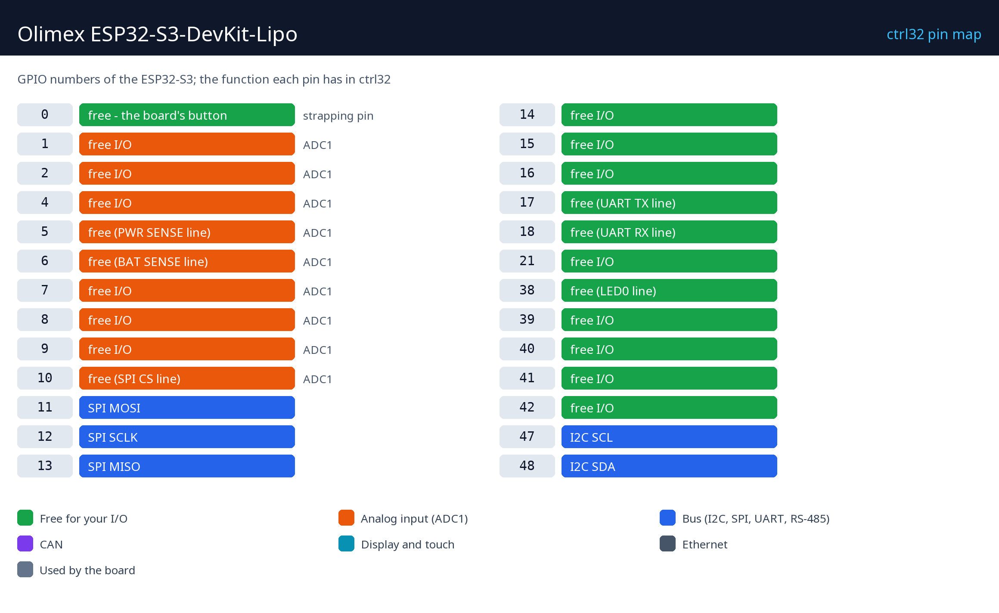

# Hardware and wiring

## What you need

- The Olimex ESP32-S3-DevKit-Lipo.
- A USB-C data cable - on the connector marked UART (the CH340X) for the upload.
- The name and the password of your 2.4 GHz Wi-Fi.
- A PC with the [ctrl32 editor](https://ctrl32.com/download/) (Windows).
- Optional, for the all-in-one example: the Boot/User button (GPIO0) and the LED (GPIO38) are on the board; a potentiometer (10 k) between 3.3 V and GND with its wiper on GPIO1; a 3.3 V CAN transceiver on GPIO10 / GPIO17 and an RS-485 transceiver on GPIO18 / GPIO2 / GPIO4 (DE).

## Power

| Source | Where | Note |
|---|---|---|
| USB 5 V | either USB-C connector | power and programming |
| Li-Po battery | the battery connector | charged on board, automatic switchover |

## Pin map

| GPIO | Function in ctrl32 | Note |
|---|---|---|
| 0 | free - the board's button | ⚠ strapping pin |
| 1 | free I/O | ADC1 |
| 2 | free I/O | ADC1 |
| 4 | free I/O | ADC1 |
| 5 | free (PWR SENSE line) | ADC1 |
| 6 | free (BAT SENSE line) | ADC1 |
| 7 | free I/O | ADC1 |
| 8 | free I/O | ADC1 |
| 9 | free I/O | ADC1 |
| 10 | free (SPI CS line) | ADC1 |
| 11 | SPI MOSI |  |
| 12 | SPI SCLK |  |
| 13 | SPI MISO |  |
| 14 | free I/O |  |
| 15 | free I/O |  |
| 16 | free I/O |  |
| 17 | free (UART TX line) |  |
| 18 | free (UART RX line) |  |
| 21 | free I/O |  |
| 38 | free (LED0 line) |  |
| 39 | free I/O |  |
| 40 | free I/O |  |
| 41 | free I/O |  |
| 42 | free I/O |  |
| 47 | I2C SCL |  |
| 48 | I2C SDA |  |

The headers carry the free GPIO; ADC1 (the analog inputs ctrl32 uses) is on
GPIO1 to GPIO10. GPIO0 is the Boot/User button - an input in the program,
and held at power-on it starts the chip's download mode. The pUEXT
connector carries I2C (GPIO48 / GPIO47) and SPI.

## Safety

- The board is not intended for safety functions. An emergency stop, a
  door switch or a light curtain is wired in hardware, never through a
  program.
- The GPIO pins are 3.3 V. A 24 V signal needs an opto-coupler or a level
  shifter; a relay coil needs a driver (a relay module has one).

---

[← Overview](README.md) | [Overview](README.md) | [Install the runtime →](install.md)
