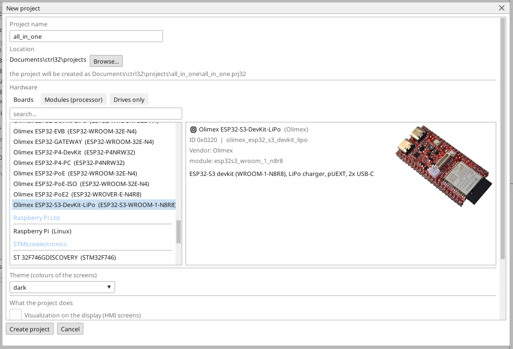
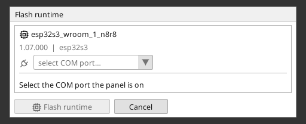
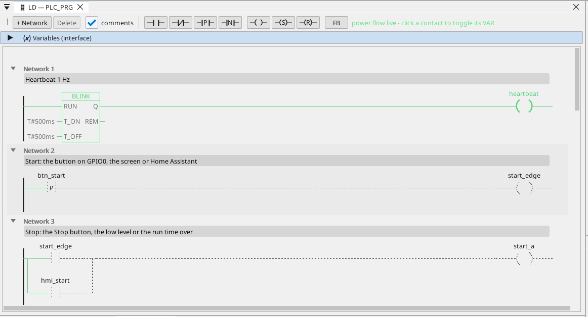

# A ctrl32 runtime telepítése

A runtime az a program a panelen, amely a projektedet futtatja - a PLC ciklust, a képernyőket, a kommunikációt. Egyszer kerül a panelre; utána a projekt minden módosítása egy letöltés, amely csak a projektet írja felül.

## 1. A panel csatlakoztatása

Csatlakoztasd a panelt USB-kábellel a PC-hez. A feltöltéshez a **CH340X** átalakító USB-C csatlakozóját használd. A
Windows 10 és 11 magától telepíti az illesztőprogramját; ha a port nem
jelenik meg, telepítsd a chip gyártójának (WCH) CH340 illesztőprogramját.
A másik csatlakozó a chip natív USB-je - az is táplálja a panelt.

## 2. A projekt létrehozása

Indítsd el a ctrl32 szerkesztőt, és válaszd a **New project** pontot (Ctrl+N). Írd be a projekt **nevét**, válaszd ki a(z) **Olimex ESP32-S3-DevKit-LiPo** panelt a panelek listájában (a(z) **Olimex** alatt), és nyomd meg a **Create project** gombot.

Ha inkább a kész példából indulnál, nyisd meg az [all-in-one projektet](examples/all-in-one/README.hu.md) (**File → Open**).

## 3. A runtime megírása

Válaszd ki a panel COM portját az eszköztár portválasztójában, kattints a panelre az eszközfában, és nyomd meg a **Flash runtime** gombot. A szerkesztő megírja a runtime-ot, visszaolvassa és ellenőrzi; körülbelül egy percig tart, és a panel újraindul. Ezt egyszer kell megcsinálni - és újra csak akkor, ha a szerkesztő új runtime-vonalat hoz.

## 4. A projekt letöltése

Nyomd meg a letöltés gombot az eszköztáron (F5). A szerkesztő lefordítja a projektet, beírja a panel inaktív programslotjába, ellenőrzi, és csak ezután vált át - egy sikertelen letöltés érintetlenül hagyja a futó programot.

## 5. Ellenőrizd, hogy fut

Nyomd meg az **ONLINE** gombot (a dugó ikon a portválasztó mellett), hogy figyeld a programot a panelen: ami vezet, az zöld, és minden változó az élő értékét mutatja. Ha nincs kéznél panel, ugyanezt a nézetet adja a **szimuláció** (az eszköztár gombja az ONLINE mellett).

Valami nem működik? Lásd [Hibaelhárítás](troubleshooting.hu.md).

*Képernyőképek: ctrl32 szerkesztő 1.07.*

---

[← Hardver és bekötés](hardware.hu.md) | [Áttekintés](README.hu.md) | [Beállítás →](configure.hu.md)
