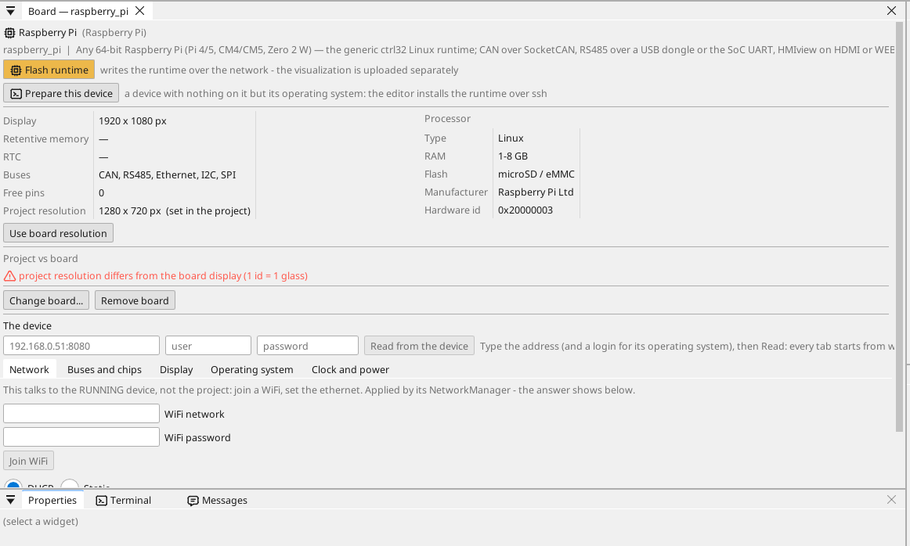
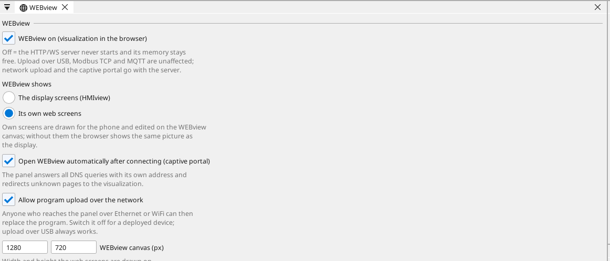

# Kartı yapılandırın

## Kart sayfası

Cihaz ağacında karta çift tıklayın. Sayfa kartın neler taşıdığını ve her pini gösterir: boş bir pin tek tıkla bir değişken alır - bir giriş, bir çıkış ya da analog yetenekli bir pinde analog bir giriş.

## Ağ

Pi, işletim sisteminin ağ ayarlarını korur: **Prepare a Linux device**
sabit bir adres ayarlamadıysa yönlendiriciden DHCP. Onu ana bilgisayar
adıyla ya da editörün **Find devices** özelliğiyle bulun.

## Girişler, çıkışlar ve değişkenler

Programın her sinyali bir **değişkendir**. Bir pindeki değişken pini okur veya sürer; analog bir değişken ona neyin bağlı olduğunu (bir gerilim, 4-20 mA, bir termistör) ve birim cinsinden aralığını söyler.

## İletişim

**Modbus TCP.** Ağdaki bir cihaz **Ethernet → Modbus TCP master** altında eklenir; register'ları değişken olur.

**Modbus RTU / RS-485.** Bir USB-RS485 adaptörü (`/dev/ttyUSB0`, yön kendiliğinden değişir) ya da Pi'nin UART'ında bir RS-485 HAT. ctrl32 bunun üzerinde dört hatta kadar bir Modbus RTU master veya slave'dir.

**CAN.** CAN, SPI üzerindeki bir CAN HAT'ten (MCP2515, MCP251xFD) ya da bir USB CAN adaptöründen gelir; runtime onu bir SocketCAN arayüzü olarak kullanır (`can0`, dört veri yoluna kadar). Prepare a Linux device HAT'in sürücüsünü ekler; bit hızı projeninkidir.

**MQTT.** Kart seçilen değişkenleri bir broker'a yayınlar; Home Assistant modunda broker bunları kendiliğinden bulur ve *write* olarak işaretlenen bir değişken oradan ayarlanabilir.

## Ekran

Runtime bağlı HDMI monitöre (veya bir DSI ekrana) çizer ve projeyi ona göre
ölçekler; örnek 1280 x 720'de çizilmiştir. Dokunmatik bir monitörün USB
dokunmatiği sürücüsüz çalışır. Monitör olmadan Pi ekranlarını yalnızca
tarayıcılara sunar (WEBview).

## OPC UA ve EtherCAT

- **OPC UA** - projenin her değişkeni Pi'nin kendi sunucusunda bir
  düğümdür (`opc.tcp://<adres>:4840`, `ns=1;s=<ad>`); bir değişken,
  değişken listesinde tek bir işaretle bunun dışında tutulabilir. Başka
  bir şey ayarlanmaz.
- **EtherCAT** - G/Ç terminalleri için bir USB Ethernet adaptörü üzerinde
  bir master; kısa veri yolu döngüsü olan servo sürücüler için Raspberry
  Pi 4 veya 5 daha iyi bir seçimdir.

## WEBview

Kart operatör sayfasını ağdaki her tarayıcıya sunar - kartın adresini açın. Sayfa editörde bir ekran gibi çizilir.

---

[← Runtime'ı kurun](install.tr.md) | [Genel bakış](README.tr.md) | [Örnek projeler →](examples/README.tr.md)
