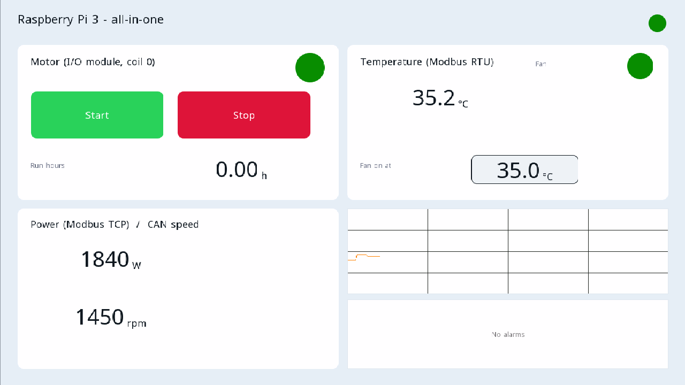

# Example projects

Each project opens in the ctrl32 editor (**File → Open**) and runs on the Raspberry Pi 3 Model B+ as it is.

| | Project | What it shows |
|---|---|---|
|  | [All-in-one](all-in-one/README.md) | A motor and a fan on a Modbus RTU I/O module, controlled from the HDMI screen, WEBview and Home Assistant, with a Modbus TCP meter, CAN frames, run hours, a trend, the alarms and every variable on OPC UA. |

---

[← Configure](../configure.md) | [Overview](../README.md) | [Troubleshooting →](../troubleshooting.md)
