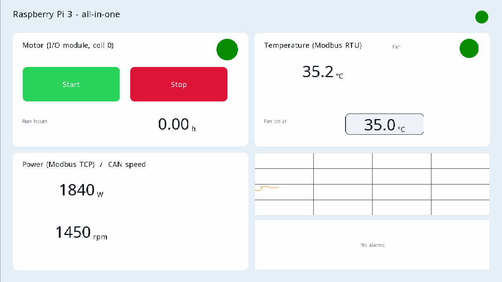

# Örnek projeler

Her proje ctrl32 editöründe açılır (**File → Open**) ve Raspberry Pi 3 Model B+ üzerinde olduğu gibi çalışır.

| | Proje | Ne gösterir |
|---|---|---|
|  | [All-in-one](all-in-one/README.tr.md) | Bir Modbus RTU G/Ç modülündeki bir motor ve bir fan; HDMI ekrandan, WEBview'dan ve Home Assistant'tan kontrol edilir; bir Modbus TCP sayacı, CAN çerçeveleri, çalışma saatleri, bir trend, alarmlar ve OPC UA'da her değişkenle. |

---

[← Yapılandırma](../configure.tr.md) | [Genel bakış](../README.tr.md) | [Sorun giderme →](../troubleshooting.tr.md)
