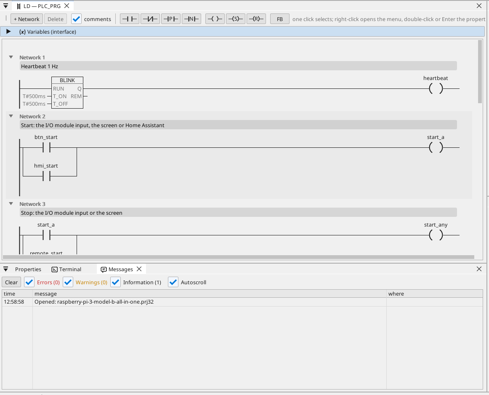

# All-in-one

Ein Motor und ein Lüfter an einem Modbus-RTU-I/O-Modul, gesteuert vom HDMI-Bildschirm, aus WEBview und aus Home Assistant, mit einem Modbus-TCP-Zähler, CAN-Telegrammen, Betriebsstunden, einem Trend, den Alarmen und jeder Variablen auf OPC UA.

**Download:** [all-in-one.prj32](all-in-one.prj32) - öffnen Sie es im ctrl32-Editor (**File → Open**).

## Was es tut

Das Programm ist eine kleine Maschinensteuerung auf der Linux-Runtime:

- **Ein- und Ausgänge** kommen von einem **Modbus-RTU-I/O-Modul**
  (Unit 2) an einem USB-RS485-Adapter: Start auf Eingang 0, Stopp auf
  Eingang 1, der Motor auf Coil 0 und der Lüfter auf Coil 1.
- **Start** kommt auch vom Bildschirm und aus Home Assistant über MQTT;
  **Stopp** vom Bildschirm.
- Die **Temperatur** kommt von einem **Modbus-RTU**-Sensor auf derselben
  Leitung (Unit 1); der Lüfter folgt ihr mit Hysterese.
- Die **Betriebsstunden** zählen jede Sekunde des Laufs und überstehen
  einen Stromausfall.
- Ein **Modbus-TCP**-Zähler liefert die bezogene Leistung; **CAN** (ein
  HAT, `can0`) sendet den Zustand von Motor und Lüfter im Telegramm
  0x181 und empfängt eine Drehzahl im Telegramm 0x281.
- Der Bildschirm läuft auf dem **HDMI**-Monitor; eine einfachere Seite
  in jedem Browser (**WEBview**); jede Variable liegt auf dem
  **OPC-UA**-Server.

## Das Programm

## Die Bedienseite

## Öffnen und ausführen

1. Öffnen Sie `all-in-one.prj32` im Editor.
2. Ändern Sie die Adressen (das Modbus-Gerät, den MQTT-Broker) auf die Ihres Netzwerks.
3. Starten Sie die **Simulation** (Symbolleiste), um es am PC auszuprobieren, oder laden Sie es auf das Board - siehe [Runtime installieren](../../install.de.md).

## Was Sie sehen sollten

Der Bildschirm erscheint auf dem Monitor. Drücken Sie **Start**: die
Motor-LED leuchtet und Coil 0 des Moduls schaltet. Der Trend zeichnet
die Temperatur; ein OPC-UA-Client (zum Beispiel ein SCADA) findet jede
Variable unter Objects > ctrl32.

---

[← Beispielprojekte](../README.de.md) | [Übersicht](../../README.de.md)
