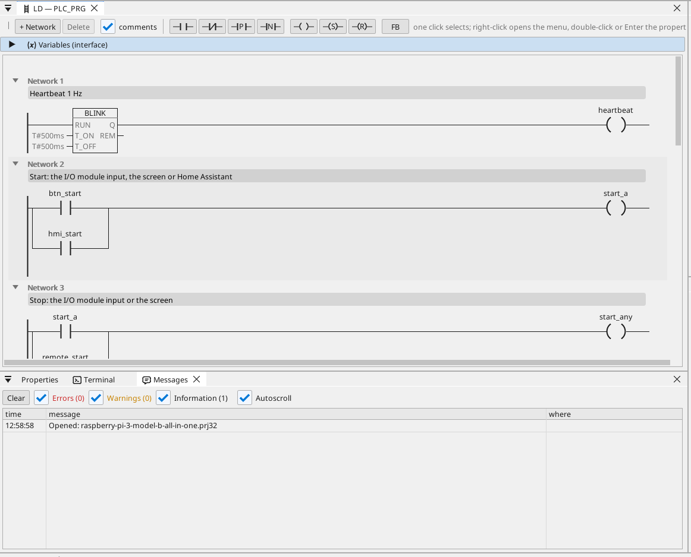

# All-in-one

Un motor y un ventilador en un módulo de E/S Modbus RTU, controlados desde la pantalla HDMI, WEBview y Home Assistant, con un contador Modbus TCP, tramas CAN, horas de funcionamiento, una tendencia, las alarmas y cada variable en OPC UA.

**Descarga:** [all-in-one.prj32](all-in-one.prj32) - ábrelo en el editor ctrl32 (**File → Open**).

## Qué hace

El programa es un pequeño control de máquina en el runtime Linux:

- Las **entradas y salidas** llegan de un **módulo de E/S Modbus RTU**
  (unidad 2) en un adaptador USB-RS485: marcha en la entrada 0, paro en
  la entrada 1, el motor en la bobina 0 y el ventilador en la bobina 1.
- **Start** llega también desde la pantalla y desde Home Assistant por
  MQTT; **Stop** desde la pantalla.
- La **temperatura** llega de un sensor **Modbus RTU** en la misma
  línea (unidad 1); el ventilador la sigue con histéresis.
- Las **horas de funcionamiento** cuentan cada segundo de marcha y se
  conservan tras un corte de corriente.
- Un contador **Modbus TCP** da la potencia demandada; **CAN** (un HAT,
  `can0`) envía el estado del motor y del ventilador en la trama 0x181
  y recibe una velocidad en la trama 0x281.
- La pantalla funciona en el monitor **HDMI**; una página más sencilla
  en cualquier navegador (**WEBview**); cada variable está en el
  servidor **OPC UA**.

## El programa

## La página del operador

## Abrirlo y ejecutarlo

1. Abre `all-in-one.prj32` en el editor.
2. Cambia las direcciones (el dispositivo Modbus, el broker MQTT) por las de tu red.
3. Inicia la **simulación** (barra de herramientas) para probarlo en el PC, o descárgalo a la placa - consulta [Instalar el runtime](../../install.es.md).

## Qué deberías ver

La pantalla aparece en el monitor. Pulsa **Start**: el LED del motor se
enciende y la bobina 0 del módulo conmuta. La tendencia dibuja la
temperatura; un cliente OPC UA (por ejemplo un SCADA) encuentra cada
variable bajo Objects > ctrl32.

---

[← Proyectos de ejemplo](../README.es.md) | [Resumen](../../README.es.md)
