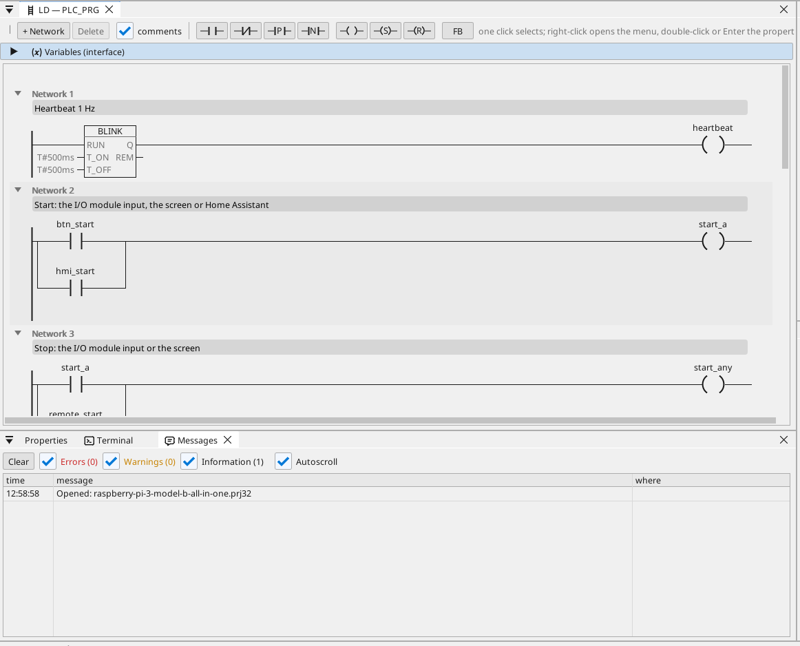

# All-in-one

Un motor și un ventilator pe un modul I/O Modbus RTU, comandate de pe ecranul HDMI, din WEBview și din Home Assistant, cu un contor Modbus TCP, cadre CAN, ore de funcționare, un trend, alarmele și fiecare variabilă pe OPC UA.

**Descărcare:** [all-in-one.prj32](all-in-one.prj32) - deschide-l în editorul ctrl32 (**File → Open**).

## Ce face

Programul este un mic controler de mașină pe runtime-ul Linux:

- **Intrările și ieșirile** vin de la un **modul I/O Modbus RTU**
  (unit 2) pe un adaptor USB-RS485: start pe intrarea 0, stop pe
  intrarea 1, motorul pe coil 0 și ventilatorul pe coil 1.
- **Start** vine și de pe ecran și din Home Assistant prin MQTT;
  **Stop** de pe ecran.
- **Temperatura** vine de la un senzor **Modbus RTU** de pe aceeași
  linie (unit 1); ventilatorul o urmează cu histerezis.
- **Orele de funcționare** numără fiecare secundă de funcționare și se
  păstrează la o pană de curent.
- Un contor **Modbus TCP** dă puterea consumată; **CAN** (un HAT,
  `can0`) trimite starea motorului și a ventilatorului în cadrul 0x181
  și primește o turație în cadrul 0x281.
- Ecranul rulează pe monitorul **HDMI**; o pagină mai simplă în orice
  browser (**WEBview**); fiecare variabilă este pe serverul
  **OPC UA**.

## Programul

## Pagina operatorului

## Deschide-l și rulează-l

1. Deschide `all-in-one.prj32` în editor.
2. Schimbă adresele (dispozitivul Modbus, brokerul MQTT) cu cele ale rețelei tale.
3. Pornește **simularea** (bara de instrumente) pentru a-l încerca pe PC sau descarcă-l pe placă - vezi [Instalarea runtime-ului](../../install.ro.md).

## Ce ar trebui să vezi

Ecranul apare pe monitor. Apasă **Start**: LED-ul motorului se aprinde
și coil 0 al modulului comută. Trendul desenează temperatura; un client
OPC UA (de exemplu un SCADA) găsește fiecare variabilă sub
Objects > ctrl32.

---

[← Proiecte exemplu](../README.ro.md) | [Prezentare](../../README.ro.md)
