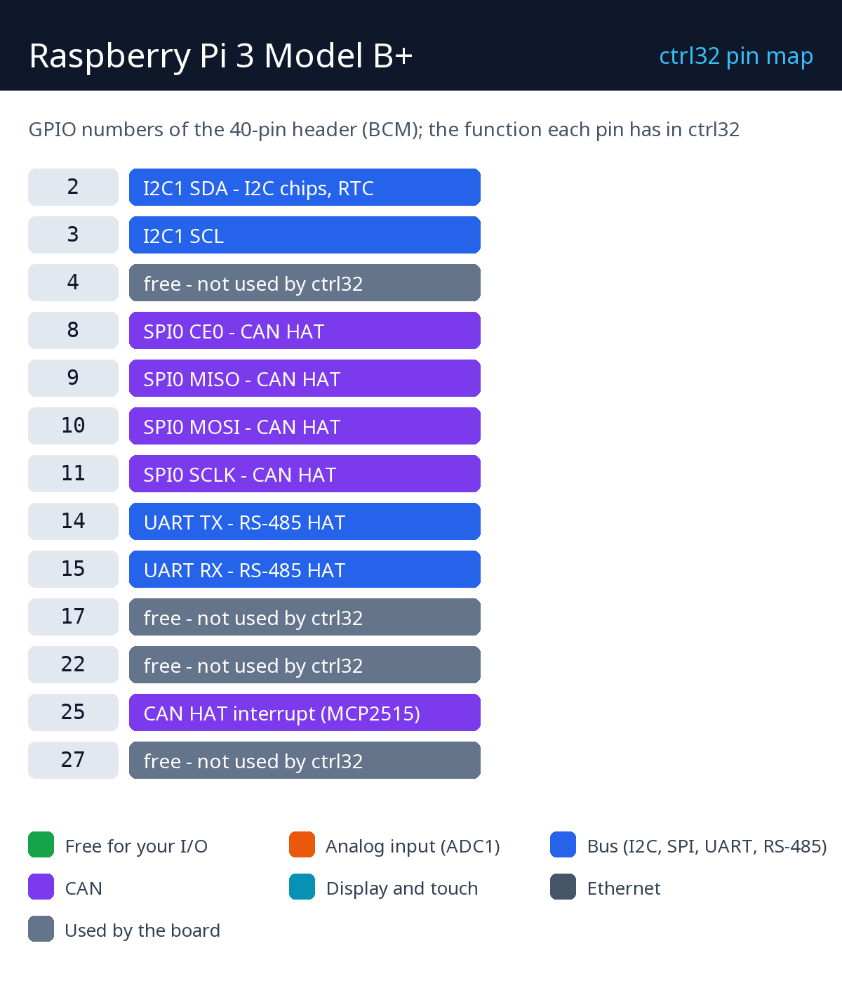

# Обладнання та підключення

## Що вам потрібно

- Raspberry Pi 3 Model B+.
- Карта microSD (16 ГБ або більше) і [Raspberry Pi Imager](https://www.raspberrypi.com/software/).
- Блок живлення micro-USB 5 В / 2,5 А.
- Кабель Ethernet у тій самій мережі, що й ПК.
- Для HMI: HDMI-монітор (повнорозмірний HDMI) або DSI-дисплей; для сенсорного монітора - також його USB.
- ПК з [редактором ctrl32](https://ctrl32.com/download/) (Windows).
- Необов'язково, для прикладу all-in-one: адаптер USB-RS485 з модулем вводу/виводу Modbus RTU і датчиком температури; CAN HAT (MCP2515).

## Живлення

| Джерело | Де | Примітка |
|---|---|---|
| micro-USB | роз'єм живлення | 5 В / 2,5 А |
| PoE | через PoE HAT | необов'язково |

!!! warning "Знижена напруга"
    Зі слабшим блоком живлення Pi знижує частоту й обмежує струм USB -
    тоді адаптер USB-RS485 або сенсорний монітор може відключитися.

## Карта пінів

| GPIO | Функція в ctrl32 | Примітка |
|---|---|---|
| 2 | I2C1 SDA - мікросхеми I2C, RTC |  |
| 3 | I2C1 SCL |  |
| 4 | вільний - не використовується ctrl32 | ⚠  |
| 8 | SPI0 CE0 - CAN HAT |  |
| 9 | SPI0 MISO - CAN HAT |  |
| 10 | SPI0 MOSI - CAN HAT |  |
| 11 | SPI0 SCLK - CAN HAT |  |
| 14 | UART TX - RS-485 HAT |  |
| 15 | UART RX - RS-485 HAT |  |
| 17 | вільний - не використовується ctrl32 | ⚠  |
| 22 | вільний - не використовується ctrl32 | ⚠  |
| 25 | переривання CAN HAT (MCP2515) |  |
| 27 | вільний - не використовується ctrl32 | ⚠  |

На Linux-платі шини - це **імена пристроїв**, а не піни: runtime відкриває
те, що названо в налаштуваннях пристрою - `can0` для CAN HAT або
USB-адаптера, `/dev/ttyUSB0` для адаптера USB-RS485 (або власний UART Pi з
RS-485 HAT). **Prepare a Linux device** налаштовує їх (крок 3
встановлення). Другий порт Ethernet для EtherCAT - це USB-адаптер
Ethernet.

## Безпека

- Плата не призначена для функцій безпеки. Аварійна зупинка, дверний
  вимикач або світлова завіса підключаються апаратно, ніколи через
  програму.
- Де можливо, вимикайте Pi перед від'єднанням живлення - runtime зберігає
  енергонезалежні значення, а операційна система віддає перевагу
  коректному завершенню роботи.

---

[← Огляд](README.uk.md) | [Огляд](README.uk.md) | [Встановлення runtime →](install.uk.md)
