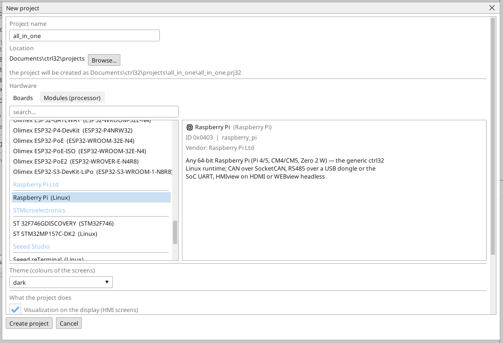
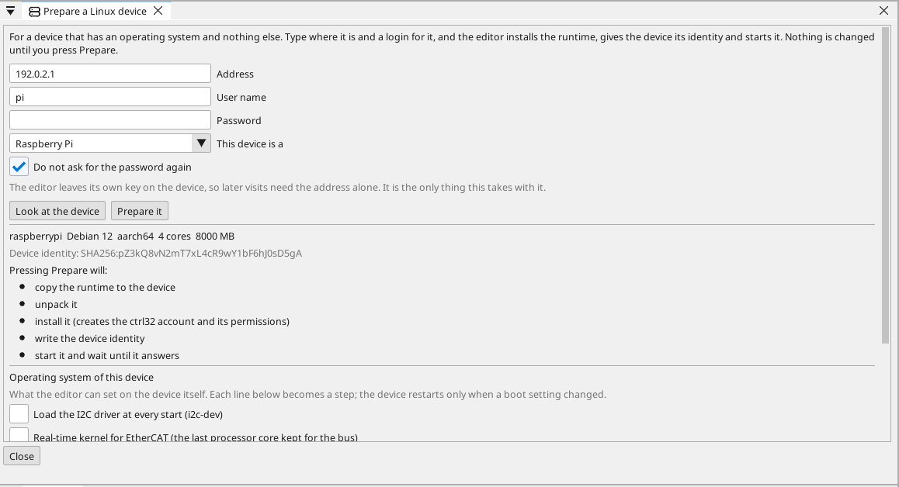
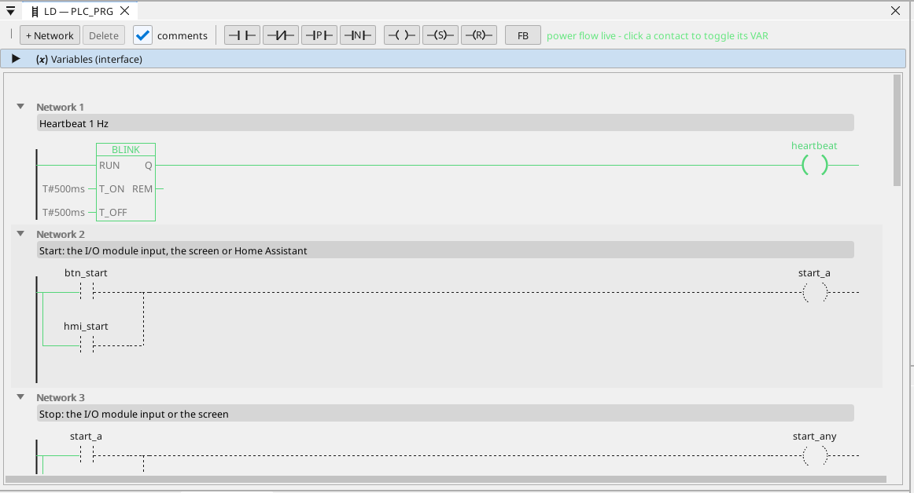

# Install the ctrl32 runtime

The ctrl32 Linux runtime is the program on the board that runs your project - the PLC cycle, the screen on the monitor, WEBview, OPC UA and the buses. The editor installs it over the network; no Linux command is typed.

## 1. Write the card

Write **Raspberry Pi OS Lite (64-bit)** to the card with the Raspberry Pi
Imager. *Lite* is deliberate: the runtime draws the screen itself and
needs no desktop. In the Imager's settings, before writing, set:

- a **hostname** you will recognise on the network,
- a **user** and its **password**,
- **SSH enabled**,
- the Wi-Fi only if the Pi will not be on a cable.

Put the card in the Pi, connect Ethernet and the monitor, and power it on.

## 2. Create the project

Start the ctrl32 editor and choose **New project** (Ctrl+N). Type the project's **name**, pick **Raspberry Pi** under **Linux** and press **Create project**.

To start from the ready example instead, open the [all-in-one project](examples/all-in-one/README.md) (**File → Open**).

## 3. Prepare the board

Choose **Online → Prepare a Linux device**. Type the board's **address**, the **user** and the **password** from step 1 and press **Look at the device**: the editor logs in, reads what the board is and lists what it will do - looking changes nothing. Then press **Prepare it**: the editor copies the runtime over, installs it as a service, starts it and waits until it answers. From then on the board starts the runtime at every boot.

Leave **Do not ask for the password again** ticked: the editor puts its own key on the board, and later visits need the address alone. The password is used once and never stored.

Under the plan, **Operating system of this device** holds what belongs to
the Pi rather than to the project: the CAN HAT (one row per CAN chip on
SPI), freeing the serial port for an RS-485 HAT, I2C, a fixed address,
and the real-time kernel for EtherCAT. Tick what your Pi carries; each
ticked line is one step, and the Pi restarts only when a boot setting
changed.

## 4. Download the project

Type the board's address into the toolbar's port picker and press the download button (F5). The runtime loads the project and the screen comes up on the monitor.

## 5. Check that it runs

- **ONLINE** (the plug icon) shows the live values in the rungs, the variables and the screen.
- **WEBview**: `http://<address>:8080` in a browser on the same network.
- **OPC UA**: `opc.tcp://<address>:4840` - every variable is a node, `ns=1;s=<name>`.

| Port | What lives there |
|---|---|
| 8080 | WEBview, the program upload, finding the device |
| 4840 | the OPC UA server |
| 3232 | the editor's online connection |

Something does not work? See [Troubleshooting](troubleshooting.md).

*Screenshots: ctrl32 editor 1.07.*

---

[← Hardware and wiring](hardware.md) | [Overview](README.md) | [Configure →](configure.md)
